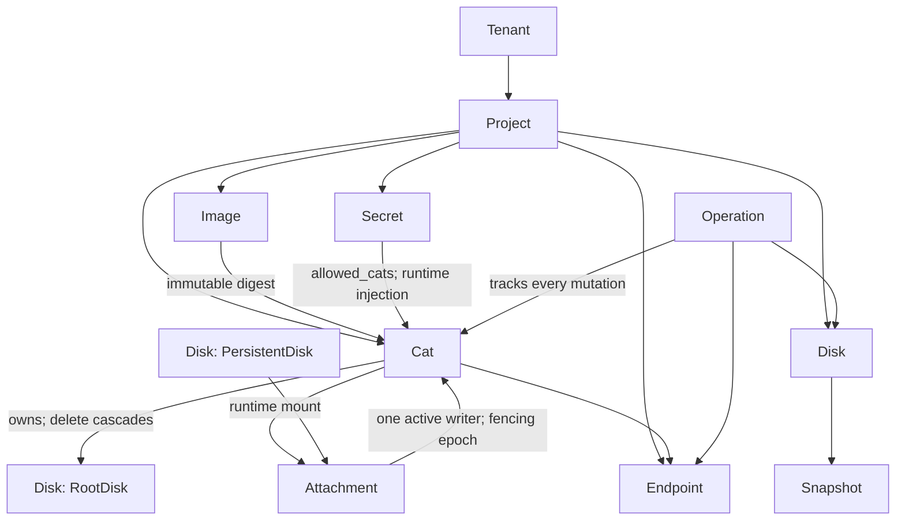
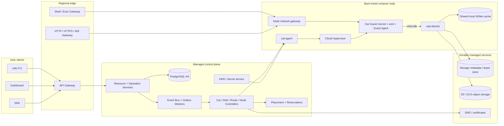

# Cats 完整产品与技术架构

> Agent 阅读约定：本文描述目标架构，不代表所有模块已经实现。事实性性能结论以[实验总报告](experiments-2026-07-21-storage-lifecycle.md)及其原始 CSV 为准；跨组件硬性决定以 [`docs/decisions/`](decisions/) 中的 ADR 为准。

## 1. 最终结论

Cats 是一套“可休眠、可迁移、带持久磁盘和稳定网络入口的 Linux microVM”产品。用户只操作 Cat、Disk、Snapshot、Endpoint、Secret 和 Image；KVM、对象存储、NVMe、vhost-user、Chunk/Manifest、租约和节点网络全部是平台内部实现。

**产品单位：一个 Cat = 一台长期存在的 Linux microVM**

它有固定名称、RootDisk、私网身份和可选公网 Endpoint。计算可以停止，磁盘和名称继续存在；再次启动时可以落到另一台 Host。

**隔离边界：KVM + Cloud Hypervisor**

每个 Cat 有独立 Guest Kernel，不与其他租户共享内核。Node 上的 cat-agent 负责 VMM、块后端、tap、cgroup 和生命周期，不允许用户接触 Host。

**控制面：声明式资源 + 异步 Operation**

`cats` CLI、Dashboard 和 SDK 调用同一套版本化 API。PostgreSQL 保存权威状态；Controller 通过 reconcile 将 desired state 收敛为 observed state。

**数据面：Host 本地热路径，远端服务作持久底座**

VM I/O、网络转发和 exec 数据流不经过中央 API 进程。RootDisk/PersistentDisk 以 ext4 块设备呈现，NVMe 加速，对象存储保存可恢复副本。

**首发架构：**控制面运行在托管 Kubernetes/EKS；PostgreSQL、对象存储、KMS 和 DNS 使用云托管服务；计算节点是独立裸金属池，运行 systemd 管理的 cat-agent、Cloud Hypervisor、cats-blockd 和节点网关。控制面故障不应立即中断已经运行的 Cat。

**明确不做：**首版不承诺保留进程内存的跨 Host 实时迁移，不做同一 PersistentDisk 的多写挂载，不向 Guest 暴露对象存储和内部元数据，不让控制面数据库承载磁盘数据，也不把 Kubernetes Pod 当作用户 Cat。

### 1.1 当前证据与目标生产版的关系

| 能力 | 新仓库现状 | 生产目标 | 状态 |
|----|----|----|----|
| CLI / API / UI | 只有目标设计；旧控制面代码未迁移 | 统一命名为 `cats`，API 版本化，所有写操作返回 Operation | Greenfield 待实现 |
| VM | 仓库保存 Cloud Hypervisor bare-metal 生命周期实验和结果 | 固定版本矩阵、节点隔离、cgroup、升级和故障恢复 | 机制已验证，产品代码待实现 |
| 网络 | 单 Node per-Cat tap `/30`、Host SNAT 和敏感目标阻断已实现并在真实 CH Guest 验证 | HA Edge、DNS/TLS 自动化、私网 overlay、策略与限流 | 基础出站已实现；完整网络待实现 |
| 存储 | 保存 lazy-ext4、JuiceFS-shaped 和 Direct-OS（Direct-S3 实现）实验 | RootDisk + 单写 PersistentDisk、fencing、快照、GC、灾难恢复 | 正确性阻断项 |
| 控制面数据 | 只有资源模型、事务和 outbox 设计 | PostgreSQL HA、事务 outbox、分区 controller、审计和备份 | 待实现 |
| SaaS | 只有产品范围和接口设计 | 身份、项目/RBAC、账单、配额、审计和支持流程 | 后续实现 |
| Direct-S3（Direct-OS 实现） | Python/NBD demo 证明未修改 ext4 可从空缓存 lazy 恢复 | Rust vhost-user-blk、Map、Pending Pack、Lease、Delta、GC | 已选定后端（ADR-0003），生产实现待完成 |

## 2. 产品定义与边界

目标用户需要一个随时可进入的 Linux 环境：可以 clone Git 仓库、安装依赖、运行服务、暴露临时或长期 URL；闲置时不继续占用昂贵计算和本地 NVMe，恢复时文件仍在。

### 交互开发环境

用户通过 `cats shell`、IDE tunnel 或 `cats exec` 进入完整 Linux VM。RootDisk 保存源码、工具链和系统修改，停止后可恢复。

- 独立 Linux Kernel
- 可安装 apt/npm/pip 等软件
- Git 与本地文件系统语义一致
- 支持长时间闲置后唤醒

### 持续运行的轻量服务

Cat 可运行 HTTP/WebSocket 服务，并通过稳定域名对外提供访问。Route 与 Cat 名称绑定，不与某一台 Host 绑定。

- 托管 TLS
- 健康检查
- 可配置自动唤醒
- 流量与日志可观测

### 可丢计算、不可丢磁盘

Cat 的 CPU/RAM 是可回收资源。RootDisk 与 Cat 同生命周期；PersistentDisk 独立存在，可从一个 Cat 卸载后挂到另一个 Cat。

- 对象存储为持久底座
- NVMe 是缓存
- 跨 Host 冷启动
- 用户看不到存储内部实现

### 2.1 用户可感知的产品承诺

| 承诺 | 准确含义 | 不包含什么 |
|----|----|----|
| 持久 RootDisk | 成功完成 Guest `fsync`/`FLUSH` 的数据在正常冷停或 Host 丢失后可从远端恢复 | 未 flush 的页缓存、进程内存和打开但未落盘的数据不保证 |
| 稳定名称 | Cat 的 ID、私网服务名和公开 Endpoint 不因重新调度而改变 | 长连接在 Host 故障时仍会断开，客户端需要重连 |
| 按需计算 | Cold 状态不占用 vCPU/RAM 和专属 NVMe；启动时重新分配 Host | 不保证 Cold 后保留进程和 TCP 连接 |
| 强隔离 | 用户工作负载运行在 KVM Guest 中，Guest 无云凭证、无 Host 文件访问权 | 不是硬件专属实例；CPU、网络和 Host Cache 仍是共享资源 |
| 单写持久盘 | 同一 PersistentDisk 在任意时刻最多只有一个有效读写 Attachment | 首版不提供 RWX，也不允许两个 Cat 同时挂载同一 ext4 |

### 2.2 版本范围

### V1 必须有

- Linux x86_64 Cat；固定 CPU/内存规格
- RootDisk、可选 RWO PersistentDisk、扩容
- create / shell / exec / start / stop / destroy
- HTTP/HTTPS/WebSocket Endpoint
- 镜像模板、Secret 注入、日志和基础指标
- 单 Region 多节点、Host 故障冷恢复
- 团队/项目隔离、API Token、审计、用量账本

### 后续能力

- 跨 Region 复制和灾备切换
- 保留内存的跨 Host 迁移
- GPU、ARM64、嵌套虚拟化
- UDP、任意 L4 公网端口、固定出口 IP
- 共享文件系统型 RWX Volume
- 用户自带 VPC / 私有连接
- Delta Pack、Compaction 与预取等存储优化（后端本体见 ADR-0003）

## 3. 资源模型

API 必须围绕稳定资源建模，而不是围绕某台 Host 上的进程建模。Host、VMM PID、tap 名和 socket 是实现细节；Cat、Disk、Endpoint、Snapshot 是用户资源。



| 资源 | 关键字段 | 生命周期与不变量 |
|----|----|----|
| Tenant | `tenant_id, plan, status, quotas` | 所有资源必须属于一个 Tenant；跨租户查询在数据库与 API 两层拒绝 |
| Project | `project_id, region, network_cidr, budget` | Region 固定；成员、资源、账单和私网的管理边界 |
| Cat | `cat_id, spec, image_id, root_disk_id, desired_state, observed_state, generation` | RootDisk 必须存在；Cat 删除最终级联删除 RootDisk，不删除外接盘 |
| Disk | `disk_id, kind, size, backend, state, current_root` | Root 或 Persistent；只能扩容；RWO；删除前必须无有效 Attachment |
| Attachment | `attachment_id, disk_id, cat_id, node_id, lease_epoch, expires_at` | 唯一 active writer；epoch 单调增加；旧 epoch 永远不能再次提交 |
| Endpoint | `endpoint_id, hostname, target_port, protocol, wake_policy` | 名称稳定；绑定随 Cat 位置变化；解绑时不能误路由到旧 Guest |
| Image | `image_id, version, digest, kernel_abi, status, signature` | 已发布版本不可变；RootDisk 从明确 digest 创建，不直接依赖 mutable tag |
| Snapshot | `snapshot_id, disk_id, root_ref, generation, state` | 不可变；Clone/Restore 指向同一只读根；删除走 grace period + GC |
| Secret | `secret_id, ciphertext, key_version, allowed_cats` | 控制面不保存明文；不得进入 Image、日志、命令行或 registry event payload |
| Operation | `operation_id, kind, resource_id, idempotency_key, phase, error` | 每次变更可查询、可重试、可审计；同一幂等键不得产生两套资源 |

## 4. 用户接口与端到端流程

`cats` 是唯一主 CLI。命令只描述用户意图，不暴露 node_id、S3 prefix、内部 metadata、tap、socket 或 vhost-user 参数。Dashboard 和 SDK 使用同一 API。

``` code-block
# 登录和选择 workspace（登录与选择分离；命令可用 --workspace 临时覆盖）
cats login
cats workspace list
cats workspace use acme-dev

# 创建 Cat；RootDisk 自动创建
cats create dev --image ubuntu-24.04 --cpus 4 --memory 8GiB --root-size 100GiB

# 可选：创建时增加独立持久盘
cats create build --cpus 8 --memory 16GiB \
  --disk cache-data --disk-size 200GiB --mount-at /data

# 进入、执行和传文件
cats shell dev
cats exec dev -- git status
cats cp ./config.json dev:/workspace/config.json
cats logs dev --follow

# 暴露 Guest 的 3000 端口；平台签发 TLS
cats expose dev 3000 --name web --protocol http
cats endpoint ls dev

# 生命周期：Suspend 保留进程状态但绑定当前 Host（内部含 Suspended/Warm 两层，见 ADR-0002）；
# Stop 释放整台 VM
cats suspend dev
cats resume dev
cats stop dev
cats start dev

# 独立持久盘可在 Cat 之间移动
cats disk create project-data --size 500GiB
cats mount project-data --cat dev --at /data
cats unmount project-data --cat dev
cats mount project-data --cat build --at /data

# Snapshot 和删除
cats snapshot create dev --disk root --name before-upgrade
cats destroy dev                  # 删除 Cat + RootDisk；project-data 保留
cats disk delete project-data    # 必须先处于 Available
```

### 4.1 `cats create` 的真实执行过程

**1. 接收意图**

API 鉴权、校验规格/配额，利用 Idempotency-Key 创建 Cat 与 Operation。

**2. 建立资源**

事务内建立 RootDisk、可选 PersistentDisk、Attachment 意图与稳定名称。

**3. 准备磁盘**

Disk Controller 从明确 Image Root 克隆系统盘；外接盘建立 sparse volume 并格式化。

**4. 调度**

Scheduler 过滤容量、Region、架构与健康状态，再按缓存亲和、分散度评分。

**5. Node 执行**

cat-agent 获取租约，启动块后端、tap、Guest 配置，再启动 Cloud Hypervisor。

**6. Guest Ready**

Guest Agent 通过 vsock 报告启动、磁盘挂载和服务状态；Node 上报 observed state。

**7. 发布路由**

Route Controller 使用新 epoch 绑定 Endpoint；Operation 变为 Succeeded，CLI 返回。

### 4.2 Shell / Exec 数据路径

> V1 已实现形态由 [ADR-0009](decisions/0009-interactive-shell-over-authenticated-websocket.md)
> 固定。长期仍可拆出独立 Session Gateway，但不能改变公开 CLI/WebSocket 契约。

### 控制建立

1.  CLI 使用 `cats login` 获得的短期 WorkOS access token 连接控制面 WebSocket。
2.  控制面校验 Workspace/Cat 授权，获取并续期 work lease；Cat 非 Running 时通过既有
    reconcile 路径唤醒。
3.  控制面查 Cat 当前 Node，用独立 service credential 建立内部 WebSocket。
4.  Node 在 upgrade 前获取 runtime activity guard，通过 Unix/vsock 连接 Guest Agent。
5.  Guest Agent 建立 `/bin/sh -l` PTY，成功后会话开始转发。

### 交互数据

1.  PTY 字节、窗口 resize、exit code 在流式通道传输。
2.  V1 控制面承担受限 Session Gateway 角色并转发流量；长期拆分后 Resource API 不再
    承载终端字节。
3.  用户 access token 只允许其已验证的 Workspace；内部 service token 不进入 Guest。
4.  默认交互 shell 随 session 断开而结束；V1 不支持 detach/reconnect。
5.  各跳使用有界队列，不记录终端明文。会话审计事件仍是后续工作。

**API 行为：**创建、启动、停止、挂载、快照等长操作返回 `202 + operation_id`。CLI 默认等待并显示阶段；`--no-wait` 立即返回。网络超时后用户查询同一个 Operation，不重复创建资源。

## 5. 完整生产架构

系统分为四部分：用户入口、区域控制面、计算数据面、持久服务。蓝色虚线是控制指令，绿色实线是用户/Guest 数据，紫色点线是权威元数据，橙色点线是异步事件和遥测。



控制请求 / reconcile用户与 Guest 数据权威元数据异步事件 / 遥测

**关键解耦：**Resource API、Controller 和 PostgreSQL 不在 Guest 的块 I/O 与公网请求热路径上。控制面短暂不可用时，已经运行的 VMM、块设备和已发布 Route 可以继续服务；新建、迁移、挂盘和新的远端持久提交可能受影响。

## 6. 控制面详细设计

控制面使用声明式状态机，不把“SSH 到某台 Host 执行脚本”当作架构。所有 Node 操作都是带 generation、deadline 和幂等键的结构化 Job。

Edge

### API Gateway

OIDC/session/API token 鉴权，生成 tenant context，做请求大小、速率和并发限制。

- 拒绝客户端传入任意 tenant_id
- Request ID 与 Idempotency-Key
- API 版本协商
- 管理端与用户端网络隔离

API

### Resource Service

提供 Cat、Disk、Endpoint、Snapshot、Image 和 Secret 的事务性 CRUD。

- 只写 desired state
- 资源版本 / If-Match
- 配额预检查与 reservation
- 不直接调用 shell command

Workflow

### Operation Service

记录长任务进度和最终错误；CLI 通过轮询或 event stream 等待。

- 幂等去重
- 阶段 checkpoint
- 可取消边界
- 用户错误与平台错误分离

Controller

### Cat Controller

按 Cat generation 推动创建、启动、暂停、冷停、重建和删除。

- 每个 Cat 单写 reconcile lease
- level-triggered，自愈丢失事件
- 检测 Node observed state 漂移
- 失败使用有界退避

Controller

### Disk Controller

负责 Disk backend、Attachment、租约、快照、扩容和删除。

- RWO 唯一约束
- lease_epoch fencing
- 最后 FLUSH 门禁
- GC 与 deletion grace period

Scheduler

### Placement

过滤不可用节点，事务性预留 CPU/RAM/设备后再绑定。

- 乐观并发控制
- reservation TTL
- 失败自动释放
- 调度决策可解释

Controller

### Route Controller

Endpoint 只有在 Guest Ready 且 node binding epoch 匹配时发布。

- 证书和 DNS
- 健康状态
- 自动激活 singleflight
- 旧路由快速失效

Fleet

### Node Controller

维护节点、容量、版本、cordon/drain 和自动扩容。

- 心跳与租约
- 节点镜像版本门禁
- 故障转移批次限制
- NVMe 与硬件健康

Async

### Event Workers

处理通知、账单导出、对象清理和低优先级任务。

- 事务 Outbox
- at-least-once 消费
- 幂等 handler
- dead-letter queue

### 6.1 一次状态变更的事务边界

``` code-block
BEGIN;
  -- 1. 校验 tenant、quota、resource_version
  UPDATE cat
     SET desired_state = 'running', generation = generation + 1
   WHERE cat_id = :cat_id AND tenant_id = :tenant AND generation = :expected;

  -- 2. 创建可查询的异步操作
  INSERT INTO operation (..., resource_generation, phase)
  VALUES (..., :new_generation, 'Pending');

  -- 3. 与资源变更同事务写出事件，避免“数据库成功但消息丢失”
  INSERT INTO outbox (..., event_type, aggregate_id, generation)
  VALUES (..., 'CatDesiredStateChanged', :cat_id, :new_generation);
COMMIT;

# Outbox publisher 之后把事件投递到 Event Bus；即使事件重复，Controller 也只处理最新 generation。
```

### 6.2 一致性规则

| 规则 | 实现 | 目的 |
|----|----|----|
| 用户资源强一致 | 创建/删除/挂载/配额 reservation 使用 PostgreSQL 事务与唯一约束 | 不出现两个 RootDisk、两个有效 RWO writer 或重复计费资源 |
| 观察状态最终一致 | Node 心跳带 `node_generation + cat_generation`；Controller 定期全量扫描 | 允许心跳或消息丢失，同时最终修复漂移 |
| 命令幂等 | Job key = `resource_id/generation/action`；Node 保存最近结果 | API/队列/网络重试不会启动两个 VMM 或执行两次删除 |
| 旧执行者失效 | Node Job 和 Disk Commit 都必须携带 generation / fencing epoch | 网络分区后的旧 Node 无法覆盖新状态 |
| 事件不作唯一真相 | 事件用于唤醒；Controller 每次读取数据库当前状态再行动 | 不依赖 exactly-once 消息系统 |

## 7. 计算运行时与 Node 内部

每个 Cat 是一个 Cloud Hypervisor 进程和一组专属设备后端。cat-agent 是 Node 上唯一拥有 Host 管理权限的组件。Guest Agent 通过 vsock 接收经过控制面授权的少量 Host 操作，同时在 Guest 内通过 `/run/cats/runtime.sock` 提供不含平台凭据的 HTTP Runtime API（ADR-0007）；两条接口不能混用。

### Node 基线

- 精简不可变 Host OS；仅开放管理平面
- KVM、IOMMU、cgroup v2、nftables/eBPF、io_uring
- 本地 NVMe 分区：images、disk cache、memory、staging、logs
- cat-agent、node gateway、cats-blockd、OTel agent 由 systemd 管理
- 节点身份来自云实例身份 + 平台 PKI，不放静态管理员密钥
- 禁止用户 SSH；break-glass 操作单独审计

### 每 Cat 隔离

- 独立 KVM VM、Guest Kernel、tap、vsock CID、API socket 和工作目录
- Cloud Hypervisor/cats-blockd 各自运行在受限 UID 与 cgroup
- CPU、RAM、IOPS、带宽、进程数和文件描述符配额
- seccomp + Landlock 限定可访问路径和系统调用
- Guest 只看到 virtio 设备；没有 Host mount、S3/DB/KMS 凭证
- 实例目录名使用不可猜 UUID，不使用用户输入直接拼接路径

### 7.1 Cloud Hypervisor 设备模型

| 设备 | 用途 | Host 后端 | 约束 |
|----|----|----|----|
| `virtio-blk vda` | RootDisk | 每 Attachment 的 cats-blockd / vhost-user-blk socket | 必须先获取磁盘 epoch；FLUSH 语义通过上线测试 |
| `virtio-blk vdb...` | PersistentDisk | 同一 block engine，不同 volume 和 socket | RWO；Guest 按 filesystem UUID 挂载 |
| `virtio-net` | 私网和公网转发 | Node tap + bridge/overlay | 源地址反欺骗；每 Cat 网络策略 |
| `virtio-vsock` | Guest Agent、exec、健康和时间同步控制 | cat-agent session proxy | 不暴露到 VPC；每 Cat 唯一 CID |
| `virtio-rng` | Guest 随机数 | Host `/dev/urandom` | 启动早期可用 |
| serial/console | 启动诊断 | 本地 ring buffer + 受限日志收集 | 可能含敏感信息；短保留、租户隔离 |

### 7.2 Guest Agent 协议

### Host → Guest 控制协议（AF_VSOCK）

### 允许操作

- health / boot status
- exec / PTY / signal / resize
- syncfs / fsfreeze / unfreeze
- mount / unmount / resize2fs
- service readiness 与端口列表
- 受限文件上传/下载

### 协议要求

- 长度前缀或 HTTP/2 framed protocol
- 每请求 session token、deadline、request ID
- 命令参数数组，不经 shell 拼接
- 流量 backpressure 和输出上限
- 大文件走分块校验
- 支持 agent 版本协商

### Guest 用户程序 → Guest Agent（Unix socket HTTP）

- 固定入口 `/run/cats/runtime.sock`，HTTP/1.1 + JSON，不监听默认 TCP/UDP 端口
- `POST/PUT/DELETE/GET /v1/work-leases...` 创建、续租、释放和查看工作租约
- 不要求 Cats SDK 或 CLI；`curl --unix-socket` 等通用客户端可以直接调用
- 不携带 Cat id、控制面 token、对象存储/metadata 凭据
- Guest Agent 在内存中维护租约，通过 Host 控制协议的 `WorkStatus` 向 Node 汇总
- 该入口只能阻止自动 Suspend；Cat 已睡后，唤醒必须来自 Gateway、shell/exec 或控制面

### 明确禁止

- 接收任意 Host path
- 返回平台凭证
- 从 Guest 调控制面管理 API
- 以未经授权的 root session 执行
- 把 Secret 写到串口或 operation event
- 把 Agent 当公网应用入口

Cloud Hypervisor/VMM 不访问 Guest 内的 runtime socket，也不解析 HTTP 或租约。它只提供 virtio-vsock 设备和执行 pause/resume/snapshot 等生命周期动作。完整决定见 [ADR-0007](decisions/0007-guest-runtime-http-over-unix-socket.md)，wire contract 见 [Guest Runtime API v1](specs/guest-runtime-api.md)。

**VMM 版本策略：**Cloud Hypervisor、Guest Kernel、virtio 协议和 cats-blockd 形成兼容矩阵。Snapshot/restore 与 live migration 不假设跨 VMM 版本兼容；节点升级先 cordon，再冷迁移 Cat，旧版本节点清空后替换。

## 8. Cat 生命周期

产品层只暴露清楚的状态（[ADR-0002](decisions/0002-lifecycle-states-running-suspended-warm-cold.md)）。Suspended/Warm 追求快速恢复并保留进程状态，但都绑定当前 Host；Stop（Cold）释放 Host 资源，之后从持久 RootDisk 在任意 Host 重新启动。

| 状态 | CPU/RAM | 本地 NVMe | 远端磁盘 | 网络 | 恢复方式 |
|----|----|----|----|----|----|
| Running | 已分配，vCPU 执行 | 热缓存和可选 file-backed memory | 持续接收 FLUSH 提交 | Endpoint active | 不适用 |
| Suspended | vCPU pause；Guest RAM 可 page-out 到本地盘；VMM 保留 | 保留，绑定当前 Host | 块后端仍可完成已开始的提交 | 默认返回休眠/唤醒状态 | resume；目标 \<1s |
| Warm | 0；VMM/backend 已退出，进程状态在本地 RAM snapshot | snapshot 必须保留；clean cache 可淘汰；绑定当前 Host | 保持进入前记录的 durable generation | 默认返回休眠/唤醒状态 | 同 Host 重建 runtime + on-demand restore；目标 \<1s；失败转 Cold |
| Cold | 0；VMM 不存在 | 可全部回收 | RootDisk/PersistentDisk 是唯一恢复来源 | route 保留但 unbound | 重新调度、空缓存 boot |
| Failed | 未知或不可用 | 视 Host 状态 | 保持最后 durable generation | 旧 epoch 失效 | fence 旧 Host 后冷恢复 |
| Deleted | 无 | 清理 | RootDisk tombstone 后 GC；外接盘保留 | Endpoint 删除 | 不可恢复，除非有独立 Snapshot 保留策略 |

### 8.1 状态转换不变量

### Running → Suspended

1.  Guest Agent 执行 syncfs。
2.  等待所有要求的磁盘 FLUSH 完成。
3.  Cloud Hypervisor pause。
4.  可对 file-backed Guest RAM 执行 page-out。
5.  保持 VMM、设备 backend、tap 与 Host reservation。

恢复只执行 resume + 按需 refault，不涉及 snapshot。

### Suspended → Warm

1.  确认无未完成 Pending Commit；沿用进入 Suspended 时的 durable generation。
2.  Cloud Hypervisor 对已暂停的 VM 生成 memory/device snapshot 到本地 NVMe，并校验完整性。
3.  VMM 与 cats-blockd 退出；删除 memory backing；清理 tap。
4.  保留 Attachment/fencing epoch、Host 亲和与 Endpoint sleeping 状态；记账 snapshot bytes。

### Warm → Running

1.  同一 Cat 的 Wake singleflight；校验 snapshot 完整性与 VMM 版本匹配。
2.  容量准入：RAM headroom 与并发 restore 预算（同 Cold 级别的内存准入）。
3.  重建 tap/vsock/cgroup 与 cats-blockd（同一 epoch 续租）。
4.  新 Cloud Hypervisor 以 userfaultfd on-demand restore 恢复并 resume。
5.  Guest Ready 后发布新 activation epoch；任一步失败即丢弃 snapshot，走 Cold fallback。

### Running → Cold

1.  停止接受新 exec/deploy。
2.  Guest syncfs；应用可选 pre-stop hook 有严格 deadline。
3.  块设备执行最后 FLUSH，记录 durable generation。
4.  解绑 Endpoint，关闭 Guest/VMM。
5.  释放 Attachment runtime lease、tap、RAM 和 NVMe reservation。

MountBinding 可以保留，但 runtime Attachment 必须结束。

### Cold → Running

1.  Scheduler 选择 Node 并预留资源。
2.  Disk Controller 创建更高 attachment epoch。
3.  Node 启动空或复用的 clean cache、cats-blockd 和 tap。
4.  启动 Guest，ext4 通过 journal recovery 恢复。
5.  Guest Ready 后使用新 route epoch 发布流量。

### Host Lost → Running

1.  Node lease 超时；Controller 将 Cat 标为 Unknown。
2.  阻止快速双启：等待 fencing 条件或云 API 确认旧 Host 已关机。
3.  撤销旧 disk epoch，创建新 epoch。
4.  在新 Node 冷启动；不尝试保留内存。
5.  Ready 后切 Route；旧长连接由客户端重连。

### 8.2 自动空闲策略

**工作驱动的快速 Suspend：**V1 新建 Cat 默认开启，并允许按 Cat 显式关闭。平台 Gateway/exec/control 租约与 Guest 用户程序显式工作租约都为零、Guest 摘要新鲜且最终 quiesce fence 通过时，Running 立即尝试进入 Suspended，不等待 idle timeout，也不根据 CPU、load、网络或进程扫描猜测。需要持续后台运行的 Guest workload 必须接入工作租约或关闭该策略；信号链不确定时 fail-awake。Suspended → Warm → Cold 仍可按更长闲置时间、本机内存/backing/快照压力或 Node drain 自动降级；具体阈值属于套餐/项目策略，不写死在 VMM 实现中。详见 [工作驱动快速休眠设计](cats-auto-tier-product-and-implementation-design.md)。

**自动唤醒：**Shell/Exec 一定触发唤醒；HTTP Endpoint 是否因请求唤醒由 `wake_policy` 控制。Edge 对同一 Cat 的并发冷请求只触发一个 Activation Operation；等待超时返回 `503 + Retry-After`，不能无限占用连接。

**详细机制：**Cloud Hypervisor pause/resume 顺序、Guest RAM 如何 page-out 到本地 NVMe、snapshot/restore、Suspended/Warm/Cold 的资源账本、并发唤醒和 Host Lost 降级见 [Cats 睡眠、唤醒与 VMM 资源回收](cats-sleep-wake-vmm-resource-reclamation.md)。

## 9. 网络架构

网络分成管理、用户会话、Guest 私网和公网服务四个平面。它们使用不同端口、身份、限流和日志，不能共用一个“万能网关”。

### 管理平面

Controller ↔ cat-agent。仅私网/mTLS，传 Job、heartbeat 和结果，不传公网应用流量。

### 会话平面

目标态为 CLI ↔ Session Gateway ↔ Node ↔ vsock，用于 shell/exec/logs/cp，使用短期
单用途 token。V1 的 `cats shell` 由控制面承担 Session Gateway 角色：外层使用 WorkOS
短期 access token，控制面到 Node 使用 service credential；拆分计划见 ADR-0009。

### Guest 私网

Cat 间和出站网络。Node tap/bridge 接入 routed overlay；网络策略在 Host 执行。

**当前 V1 dev 形态：**Node 为每个 Cat 创建独立 `/30` tap，Guest 地址由 Node
分配并在启动时配置，Host 使用 SNAT 提供公网出站。Host 本机、RFC1918 私网和云
metadata 地址在 FORWARD 前显式阻断；跨 Node overlay、项目内服务发现和公网入站
仍属于后续网络里程碑。

### 公网服务

DNS/TLS/WAF/Edge → owning Node gateway → Guest port，按 Endpoint 独立鉴权和计量。

### 9.1 公网请求路径

**1. DNS**

`web.dev.acme.cats.example` 指向区域 Edge；不指向某台裸金属 Node。

**2. TLS / WAF**

Edge 选择证书、校验 Host/SNI、执行限流和最大请求策略。

**3. Route Lookup**

按 hostname 查只读缓存，得到 project/cat/node/port/epoch。

**4. Activation**

Cat 非 Running 时按 wake policy 唤醒；并发请求 singleflight。

**5. Node Hop**

通过区域私网/mTLS 或受控 tunnel 发送到 owning Node gateway。

**6. Epoch Check**

Node 再校验 route epoch 和 Guest IP，拒绝旧绑定与跨租户端口。

**7. Guest**

转发到 tap 私网地址；响应字节计入 tenant egress ledger。

### 9.2 地址与路由

| 项目 | V1 方案 | 后续扩展 |
|----|----|----|
| Guest 地址 | 每 Node 分配不重叠的私有前缀；Cat 获得固定 project 内地址或稳定 service name | IPv6 /128、用户自带地址空间 |
| 跨 Node | WireGuard routed overlay；每 Node 发布自己拥有的 Guest prefix | eBPF dataplane / cloud route integration |
| 出站 | Host SNAT，共享区域 egress；DNS 由平台 resolver 提供 | 项目固定 Egress IP、PrivateLink、NAT gateway pool |
| 入站 | HTTP/HTTPS/WS/WSS，Edge TLS termination；Guest 不需要证书 | 受限 TCP endpoint、UDP、TLS passthrough |
| 服务发现 | `<cat>.<project>.internal` → 项目内稳定地址 | 按 Endpoint 的服务别名与负载均衡 |
| 策略 | 默认同项目可达、跨项目拒绝；Endpoint 显式开放；Host 反欺骗 | 用户可配置 ingress/egress policy |

**路由安全不变量：**Route cache 的 key 必须包含规范化 hostname；结果必须包含 tenant/project/cat/node/epoch；Node gateway 必须再次验证 epoch 和目标端口。不能只相信 Edge 传来的 Guest IP，也不能让请求头直接指定后端地址。

## 10. 存储在完整架构中的位置

存储对产品暴露为块设备，对 Guest 暴露为标准 ext4。内部后端可替换，但 RootDisk/PersistentDisk、Attachment、FLUSH、Snapshot 和恢复语义必须保持不变。

**RootDisk**

Cat 创建时自动从 Golden Root 克隆；作为 `/dev/vda`；包含系统、工具和用户文件；Cat destroy 后删除。

**PersistentDisk**

可选、独立、可扩容；任意时刻只挂一个 Cat；作为 `/dev/vdb...` 并由 Guest Agent 挂到指定目录。

**后端（已选定，[ADR-0003](decisions/0003-direct-s3-chunkstore-backend.md)）**

cats-blockd 原生实现 Direct-OS ChunkStore（Direct-S3 实现）：NVMe Cache + Dirty Bitmap/Pending Commit Pack + 两级不可变 Map + S3 不可变对象 + PostgreSQL root/lease CAS。对象存储、元数据和内部格式对用户与 Guest 完全不可见。JuiceFS raw image 方案不再实现，仅作历史参考。

**实现依赖边界（[ADR-0005](decisions/0005-provider-neutral-storage-ports-and-adapters.md)）**

存储采用 Ports and Adapters：`cats-storage` 只定义 `BlobStore`、`MetadataStore`
契约、错误与 adapter factory；`adapters/` 中的独立 crate 承载 File、SQLite、
AWS S3 等具体实现。控制器和 `ChunkEngine` 只依赖 ports，厂商参数只在 composition
root 解析。V1 静态链接 adapter，不承诺动态 plugin ABI；AWS S3 是第一个 durable
object-store adapter，而不是核心代码的云依赖。

### 10.1 I/O 与持久性

| Guest 操作 | Host 行为 | 返回成功条件 | Host 丢失后的保证 |
|----|----|----|----|
| 普通 WRITE | 写入本地 cache，先保守标记 dirty | 数据已进入受管理本地写缓存 | 如果还没有 FLUSH，允许丢失 |
| FUA WRITE | 按协商能力作为带持久屏障的写处理 | 对应数据达到远端 durable root | 必须恢复 |
| FLUSH | 冻结当前 dirty set，创建 immutable Pending Commit Pack，上传并原子发布 root | 远端对象和权威 root/metadata 提交完成 | 必须恢复；可以重复执行同一 transaction |
| READ hit | 从 NVMe clean/dirty cache 返回 | 校验内存/本地元数据成功 | 不影响持久状态 |
| READ miss | 按 LBA map 从对象存储 lazy GET，校验后进入 clean cache | 下载和 checksum 通过 | 无需下载整块逻辑盘 |
| DISCARD/TRIM | 更新 sparse map / punch hole，后续随 FLUSH 发布 | 按 negotiated 语义完成 | 成功 FLUSH 后不再要求保留被 trim 的逻辑内容 |

**不是完整 WAL：**V1 使用 Dirty Bitmap + 每次 FLUSH 的 immutable Pending Commit Pack。它固定屏障前的数据集合，让屏障后的新写入进入下一组 dirty set。只有当产品要求“所有已 ACK 但未 FLUSH 的普通写在 Host 永久损坏后也不丢”时，才需要跨 Host 复制的低延迟 WAL；单机 NVMe WAL 不能解决 Host 丢失。

### 10.2 后端决策（ADR-0003）

JuiceFS-backed sparse raw 与 Direct-OS ChunkStore 曾并列为候选。2026-07-21 按 [ADR-0003](decisions/0003-direct-s3-chunkstore-backend.md) 选定 Direct-OS ChunkStore（Direct-S3 实现）作为唯一实现路径：不再实现 JuiceFS 方案，避免双层映射（ext4 block → raw offset → slice → object）的未测写放大风险和 TiKV 元数据集群的运维成本；代价是 FUA/FLUSH/GC/fencing/Map 的正确性必须全部由 Cats 自行证明，验收门槛见 Direct-S3 设计的上线决策门。历史比较保留在[存储产品蓝图（历史参考）](cats-storage-product-blueprint.md)中。

### 10.3 详细文档

- [Direct-S3 ChunkStore 详细设计](direct-s3-chunkstore-architecture.md)：已选定后端（ADR-0003）。Map、对象格式、Pending Commit、FLUSH、Lease/Fencing、Snapshot、Delta、GC 与恢复。
- [Cats 存储产品蓝图](cats-storage-product-blueprint.md)：历史参考（JuiceFS raw 方案，未采用）；RootDisk、PersistentDisk、RWO Attachment、CLI 和生命周期语义的最初出处。
- [块映射与 Lazy Load 说明](sprite-storage-flow.md)：解释 10 万小文件、稀疏逻辑盘、本地 NVMe 与对象存储的关系。
- [lazy-ext4 实验](../experiments/lazy-ext4-demo/README.md)：未修改 ext4、空缓存冷恢复、对象按需下载和崩溃注入验证。

## 11. 镜像、启动与应用交付

Cat 不是容器，但镜像分发可以复用 OCI 的内容寻址和 Registry 协议。发布产物包含 RootDisk 基线、Kernel、initramfs、Guest Agent、启动参数和兼容性元数据。

### 系统镜像流水线

1.  从固定上游 digest 构建 rootfs。
2.  安装 Guest Agent、CA、基础诊断工具。
3.  生成 ext4 Golden Root；清理 machine-id、SSH host key 等实例身份。
4.  生成 manifest：kernel ABI、agent version、filesystem UUID policy。
5.  漏洞扫描、SBOM、签名。
6.  写入不可变 digest；通过 channel 指针推广 dev → canary → stable。

### Cat 启动

1.  Image digest 决定 Kernel/Root 基线，不读取 mutable tag。
2.  RootDisk 使用 CoW clone，避免复制整个镜像。
3.  实例 metadata 使用只读 config device 或 vsock 提供。
4.  Secret 在 Guest Ready 后用一次性加密 session 注入。
5.  Guest Agent 建立 readiness；用户服务是否 Ready 单独判断。
6.  升级系统通过新建 Cat 或显式 image rebase，不静默替换用户 RootDisk。

### 11.1 两种工作负载交付方式

| 方式 | 适用场景 | 实现 | 持久性 |
|----|----|----|----|
| Interactive | 开发、调试、长期工作区 | 用户 shell 进入 Cat，自行 git clone / install / run | 所有系统和工作区变化进入 RootDisk |
| Bundle Deploy | CI 临时环境、预览服务 | `cats deploy` 引用 OCI artifact/bundle digest；Guest Agent 拉取或 Node 通过受控通道注入 | spec 写 registry；bundle 按 digest；运行结果可写 Root/PersistentDisk |

**Secret 处理：**环境变量适合短期进程 Secret，但不能进入镜像 manifest 或可读 operation payload。需要文件 Secret 时，Guest Agent 写入 tmpfs 并设置 mode/owner；用户明确选择持久化时才写 RootDisk，并提示其进入快照。

## 12. 安全与多租户

安全模型按“用户身份、平台服务身份、Node 身份、Guest 隔离、数据加密、网络策略、供应链”分层。任何一层都不能依赖“资源 ID 很难猜”。

Identity

### 用户与组织

OIDC/WorkOS 提供登录；平台数据库保存 Tenant、Project、Role 映射。

- Owner / Admin / Developer / Viewer
- 短期 session cookie
- CLI device login
- 细粒度 API token scopes

Service ID

### 服务间身份

控制面与 Node 使用短期 mTLS 身份；证书与 workload/node 属性绑定。

- Node attestation
- 自动轮换
- 按服务授权
- 撤销与 quarantine

Isolation

### Guest / Host

KVM 是主要隔离边界；VMM 和后端继续使用最小权限收缩爆炸半径。

- 非 root 进程
- seccomp / Landlock
- cgroup v2
- 最小设备与内核模块

Data

### 数据保护

传输 mTLS/TLS；远端对象使用 KMS；敏感 metadata 列应用层加密。

- 每租户或每卷 DEK
- key_version
- checksum / AEAD
- 删除与密钥销毁审计

Network

### 网络策略

Host 拦截 spoofing，默认阻断管理网和云 metadata endpoint。

- project boundary
- Endpoint allowlist
- egress DNS policy
- DDoS / WAF / rate limit

Supply chain

### 发布安全

Host image、VMM、Kernel、Guest Agent 和 Root Image 都由 digest 固定并签名。

- SBOM 和漏洞门禁
- 双人发布审批
- canary node pool
- 可回滚但不跨版本 restore

### 12.1 凭证边界

| 主体 | 可以持有 | 绝不能持有 |
|----|----|----|
| Guest | 用户显式注入的应用 Secret、一次性 session token | S3 bucket credentials、PostgreSQL DSN、KMS 主密钥、Node 证书 |
| cats-blockd | 限定 volume/epoch 的短期 token 或 Node 身份换取的对象权限 | 跨租户 bucket 全权限、控制面管理员 token |
| cat-agent | Node 身份、该 Node 当前 placement/job 的短期授权 | 任意 Tenant 用户凭证、支付提供商密钥 |
| Edge / Session Gateway | 路由读取、短期 backend session、TLS key 的受控访问 | 磁盘数据密钥、Host root 凭证 |
| 控制面 | 资源 metadata、密文 Secret、外部服务受限凭证 | 用户 RootDisk 明文内容 |

### 12.2 审计事件

``` code-block
AuditEvent {
  event_id, timestamp, request_id
  actor { type, tenant_id, user_id | service_id, source_ip }
  action                     # cat.start / disk.attach / secret.read / admin.node.drain
  resource { type, id, project_id }
  decision { allowed, policy_id, reason }
  before_version, after_version
  operation_id
  metadata                   # 不含 Secret、终端内容、磁盘内容
  integrity_hash
}
```

## 13. 调度、容量与自动扩缩

调度器处理的是资源预留和位置选择，不执行 VM 启动。必须区分硬容量、可超卖容量、缓存容量和突发容量。

### 13.1 节点资源账本

| 资源 | 记账方式 | 首版策略 |
|----|----|----|
| 内存 | Running/Suspended reservation + Host/VMM 预留；Cold 为 0 | 不超卖；Suspended page-out 仍保留逻辑 reservation，防止无法 resume |
| vCPU | 按 flavor vCPU 计；记录物理 core 和 load | 开发型池允许受控超卖；稳定服务池限制更严；策略按 pool 配置 |
| NVMe | image cache、clean disk cache、dirty/staging、memory pageout 分池 | dirty/staging 硬预留；clean cache 可驱逐；达到高水位停止新 placement |
| 网络 | 预计带宽 + 实际 bytes/pps/connections | 每 Cat shaping；高流量 Cat 触发迁移或专属 pool |
| 设备/能力 | KVM、架构、kernel、vhost-user、region/AZ、GPU 等 labels | 硬过滤，不允许调度后才发现不兼容 |

### 13.2 调度算法

``` code-block
candidates = nodes
  .filter(status == READY)
  .filter(region == project.region)
  .filter(runtime_version supports image + devices)
  .filter(free_memory >= requested_memory)
  .filter(free_dirty_nvme_reservation >= required_staging)
  .filter(network_and_tenant_constraints)

score(node) =
  + image_digest_cache_hit
  + last_rootdisk_host_affinity_if_healthy
  + warm_clean_chunk_estimate
  + binpack_score_for_cpu_and_memory
  + az_spread_score_for_project
  - node_load_and_io_pressure
  - failure_domain_concentration
  - pending_drain_or_upgrade_penalty

# 选中后事务性创建 reservation；Node 启动成功才转为 allocation，失败/超时自动释放。
```

### 13.3 裸金属扩容

### 何时扩容

- 可用内存低于未来启动需求
- 调度队列等待超过阈值
- NVMe dirty reservation 或网络接近高水位
- 计划中的 node drain/升级需要替代容量
- 按历史时段和用户预留做预测扩容

### Warm Pool

- 裸金属启动需要分钟级，不能等用户 create 时才申请
- 维护 Ready 但低负载的节点余量
- Node 加入前验证 KVM、NVMe、网络、时钟和版本
- 缩容先 cordon，再迁移/停止 Cat，清除磁盘密钥和 cache 后释放
- Spot 只用于明确允许中断的 pool

## 14. 高可用、故障恢复与 SLO

首版以单 Region 为故障边界：控制面跨 AZ，计算节点可随时丢失，磁盘远端状态必须能在另一台 Node 恢复。下列数字是上线目标，不是当前已验证承诺。

**99.9%**目标：Resource API 月可用性

**\< 1s P99**目标：Suspended/Warm → Running（同 Host）

**\< 30s P99**目标：Cold → shell ready（标准镜像）

**RPO 0（目标）**：对成功返回的磁盘 FLUSH，区域内设计目标

### 14.1 故障矩阵

| 故障 | 用户影响 | 自动处理 | 数据语义 |
|----|----|----|----|
| 单 API Pod | 重试一次请求 | LB 切换；幂等键返回原 Operation | 事务已提交则不重复；未提交则无变化 |
| Controller Pod | 长操作暂缓 | reconcile lease 到期，其他副本接管并读取当前状态 | 不影响运行中 I/O |
| PostgreSQL 主库 | 新变更/FLUSH root CAS 暂停 | 托管 HA failover；客户端重连 | 同步提交的控制 metadata 不丢；写路径回压 |
| Event Bus | 操作唤醒延迟 | Outbox 保留；Controller 周期扫描补偿 | 数据库仍是权威状态 |
| Edge 实例 | 部分连接断开 | LB 切换；客户端重连，route cache 重建 | 无磁盘影响 |
| cat-agent | 该 Node 新管理操作暂停；Guest 可继续运行 | systemd 重启；与 VMM 实际状态重建 inventory | 块后端独立存活时 I/O 继续 |
| 单 VMM | 一个 Cat 中断 | 同 Node 重启或重新调度 | 从最后 FLUSH 的 RootDisk 恢复；未 flush 写可丢 |
| 整台 Node | 该 Node 上 Cat 连接中断 | 云 fencing/Node lease 确认后，在其他 Node 批量冷恢复 | 成功 FLUSH 的磁盘恢复；RAM 丢失 |
| 对象存储限流 | 冷读和 FLUSH 变慢 | 指数退避、并发整形、clean cache 继续读；dirty 达上限后回压 Guest | 绝不能在远端未持久时返回 FLUSH 成功 |
| 区域故障 | V1 服务中断 | 按灾备 Runbook 恢复控制面与副本 | 取决于跨 Region 复制；V1 不承诺 RPO 0 |

### 14.2 Host 故障的风暴控制

**不能同时重启所有 Cat：**Node Lost 后，Recovery Controller 按租户公平、服务优先级、磁盘冷读预算和目标 Node 容量分批恢复。必须限制每秒 Activation、对象存储 GET 带宽和单 Node 并发 boot，避免一次 Host 故障放大成区域对象存储/数据库故障。

### 14.3 备份与恢复

### 控制面数据库

- Multi-AZ 同步 HA
- PITR 和每日快照
- 恢复副本定期演练
- Schema migration 前备份
- RTO/RPO 由演练结果记录

### 磁盘数据

- 对象 versioning / retention
- Snapshot root 不可变
- checksum scrub
- 可导出 raw image
- GC 有 grace period 与删除清单

### 配置与密钥

- IaC 进入版本库
- KMS key policy 备份审查
- PKI root 离线保护
- DNS/TLS 配置可重建
- break-glass 凭证定期验证

## 15. 可观测性与支持体系

每个请求和后台动作必须能沿 `request_id → operation_id → cat_id → node_id → attachment_id → route_epoch` 追踪。指标不允许只报 fleet 平均值。

| 层 | 核心指标 | 日志/事件 | 关键告警 |
|----|----|----|----|
| API | RPS、状态码、P50/P95/P99、auth/limit、DB pool | 结构化 access、actor、operation | 5xx、延迟、连接池耗尽、Webhook 验签失败 |
| Controller | queue depth、reconcile latency、retry、stuck resource | phase transition、generation、decision | 操作超时、dead letter、期望/观察状态长期漂移 |
| Scheduler | pending、filter reason、reservation、placement latency | 候选数、最终 score、拒绝原因 | 无容量、偏斜、reservation 泄漏 |
| Node/VMM | CPU、RSS、steal、VM exits、boot time、cgroup throttling | VMM event、agent job、kernel error | KVM error、NVMe SMART、心跳、VMM crash loop |
| 网络 | pps/bytes/conns、route lookup、TLS、backend latency、egress | route epoch、endpoint、reset reason | route miss、旧 epoch、连接耗尽、错误率 |
| 存储 | IOPS、latency、cache hit、dirty bytes、FLUSH、GET/PUT、GC | generation、txn、lease、checksum | dirty 高水位、FLUSH 超时、stale writer、checksum failure |
| 产品 | create/start success、cold start、shell connect、active cats | 用户可读 operation timeline | 按套餐/Region 的成功率和 SLO burn |

### 15.1 日志保留与隐私

### 平台日志

- 控制面和审计日志集中保存
- 租户字段标记且服务端强制过滤
- Token、Cookie、Secret、DSN 自动 redact
- Audit 长保留；调试日志短保留
- 支持按 request/operation/resource 导出

### Guest 日志

- 默认只收 Guest Agent 与用户显式配置的服务日志
- 串口日志仅用于 boot 失败，限大小和时间
- 用户可以关闭应用日志收集
- 不扫描 RootDisk 内容作为“日志”
- 日志存储和 egress 计入用量

## 16. 配额、计量与计费

计量必须由平台数据面产生、进入不可变 usage ledger，再聚合到发票。支付提供商只负责收款/订阅，不是资源授权的实时真相。

| 计量项 | 开始/结束 | 原始来源 | 推荐计费 |
|----|----|----|----|
| vCPU-second | Allocation Running 时间 | Cat allocation checkpoint + Node heartbeat | 按 flavor 或 vCPU 秒；Suspended/Warm/Cold 不计 vCPU |
| RAM GiB-second | Running 和保留 RAM 承诺的 Suspended | allocation 与 lifecycle event | Running 全价；Suspended 按较低系数或固定费率；Warm 不计 RAM，可按本地 snapshot 占用单独低价计费 |
| RootDisk | Cat 存在期间 | Disk logical size / remote used bytes checkpoint | 套餐含基础额度，超出按 GiB-month |
| PersistentDisk | Disk 创建到删除 | Disk allocated size | 按 provisioned GiB-month，是否挂载不影响 |
| 公网 Egress | Edge/Node 向客户端发送 | Endpoint meter | 按 GiB；内网和控制会话另设策略 |
| Snapshot | Snapshot Ready 到 Deleted | 可归属增量 bytes 或保底 logical size | 先按保留 bytes，避免 CoW 归属争议需要明确定义 |

### 16.1 Usage Ledger

``` code-block
UsageRecord {
  usage_id                 # 全局唯一，消费端去重
  tenant_id, project_id
  resource_type, resource_id
  metric                   # vcpu_second / ram_gib_second / disk_gib_second / egress_byte
  quantity, unit
  interval_start, interval_end
  source, source_generation
  dimensions               # region, pool, flavor, endpoint_id
  created_at
}

# collector 只写增量 checkpoint；聚合器可重复运行；Invoice 保存引用的 usage watermark。
```

**配额分两类：**创建时硬配额（Cat 数、vCPU、RAM、Disk 大小、Endpoint 数）在数据库事务内 reservation；运行时配额（带宽、IOPS、并发 session、API rate）由数据面 limiter 执行。账单欠费不应突然删除磁盘，应按 Active → Restricted → Suspended → Retention → Delete 的明确策略执行。

## 17. API、事件与数据库

外部 API 采用版本化 JSON/HTTPS；shell/logs 使用升级后的流式协议。内部 Node API 建议使用 gRPC/mTLS。数据库表按资源分离，不再让 Volume 同时代表 Cat、系统盘和用户身份。

### 17.1 外部 API 轮廓

``` code-block
POST   /v1/projects/{project}/cats
GET    /v1/projects/{project}/cats/{cat}
PATCH  /v1/projects/{project}/cats/{cat}          # spec / desired state
DELETE /v1/projects/{project}/cats/{cat}

POST   /v1/projects/{project}/cats/{cat}:start
POST   /v1/projects/{project}/cats/{cat}:suspend
POST   /v1/projects/{project}/cats/{cat}:stop
POST   /v1/projects/{project}/cats/{cat}:exec      # 创建短期 session

POST   /v1/projects/{project}/disks
POST   /v1/projects/{project}/disks/{disk}:attach
POST   /v1/projects/{project}/disks/{disk}:detach
POST   /v1/projects/{project}/disks/{disk}:resize
POST   /v1/projects/{project}/disks/{disk}/snapshots

POST   /v1/projects/{project}/cats/{cat}/endpoints
GET    /v1/operations/{operation}
GET    /v1/operations/{operation}/events

Headers:
  Authorization: Bearer <token>
  Idempotency-Key: <uuid>         # 所有 mutation 必须支持
  If-Match: "resource-generation"  # 防止覆盖并发修改
  X-Request-ID: <uuid>
```

### 17.2 创建响应示例

``` code-block
HTTP/1.1 202 Accepted
Location: /v1/operations/op_01J...

{
  "operation": {
    "id": "op_01J...",
    "kind": "CatCreate",
    "phase": "Running",
    "resource": "/v1/projects/dev/cats/cat_01J...",
    "progress": { "stage": "BootGuest", "completed": 5, "total": 7 },
    "error": null
  },
  "cat": {
    "id": "cat_01J...",
    "name": "dev",
    "desired_state": "Running",
    "observed_state": "Starting",
    "generation": 1,
    "root_disk_id": "disk_01J..."
  }
}
```

### 17.3 生产数据库边界

| 表组 | 主要表 | 关键约束 |
|----|----|----|
| 身份 | tenant, user, membership, project, api_token | 所有资源外键包含 tenant/project；token 只存 hash |
| 计算 | cat, cat_spec, allocation, node, node_lease, reservation | 一个 Cat 最多一个 active allocation；generation 单调 |
| 存储 | disk, attachment, disk_snapshot, disk_root, storage_job | partial unique index 保证每 Disk 一个 active RWO attachment |
| 网络 | endpoint, route_binding, ip_allocation, certificate | hostname 全局唯一；binding epoch 单调；IP 不重复 |
| 流程 | operation, operation_event, outbox, idempotency_record | tenant + idempotency key + route 唯一；事件序号递增 |
| 产品 | image, secret, audit_event, usage_record, quota_reservation | Image digest 不可变；usage_id 唯一；Secret 仅密文 |

### 17.4 Node Job

``` code-block
NodeJob {
  job_id
  node_id
  resource { cat_id, generation }
  action                 # PrepareDisk | StartVM | PauseVM | StopVM | AttachDisk | Cleanup
  spec_hash
  deadline
  authorization { tenant_id, allowed_disks[], lease_epochs[] }
}

NodeJobResult {
  job_id, attempt
  phase                  # Accepted | Running | Succeeded | Failed
  observed_resources
  error { code, message, retryable }
  started_at, finished_at
}

# cat-agent 先查本地 job journal；相同 job_id 返回原结果，不能重复启动进程或格式化磁盘。
```

## 18. 部署、升级与日常运维

控制面和计算节点采用不同发布节奏。控制面可以滚动发布；Node 组件涉及 KVM、网络和磁盘，需要 canary、cordon、drain 和版本兼容门禁。

### 控制面部署

- EKS/Kubernetes 跨 3 AZ；API/Controller 至少 3 副本
- PodDisruptionBudget、anti-affinity、HPA
- 托管 PostgreSQL Multi-AZ；连接池代理
- Event Bus 使用托管队列；Redis 只做 cache/singleflight，不是真相
- 外部 LB + WAF；私网访问数据库/KMS/S3 endpoint
- Terraform 管理网络、IAM、DB、bucket、DNS 和集群

### 计算节点部署

- 预烘焙 Host image，固定 kernel/KVM/CH/agent/blockd 版本
- Bootstrap 只做节点 attestation、拉取小配置、健康检查和注册
- Node 不加入控制面 Kubernetes worker pool，减少权限耦合
- systemd watchdog；本地状态可从进程/socket/cgroup 重建
- NVMe 每次加入/释放执行 scrub 与残留密钥清理
- 云安全组只允许管理/overlay/Node gateway 必要端口

### 18.1 Node 升级流程

**1. Bake**

构建签名 Host image；运行离线兼容和安全扫描。

**2. Canary**

新建少量 canary nodes，运行 synthetic Cat 和磁盘故障测试。

**3. Cordon**

旧 Node 停止接收新 Cat，但现有流量继续。

**4. Drain**

按预算 cold-stop/迁移 Cat；PersistentDisk 最后 FLUSH 并更新 epoch。

**5. Verify**

旧 Node allocation 为 0；无 dirty/pending commit；路由全部移走。

**6. Replace**

删除旧 Node，清理身份与磁盘；加入新版本容量。

**7. Rollout**

按 failure domain 分批，监控 SLO 和恢复测试，异常立即停止。

### 18.2 数据库迁移原则

**Expand / Migrate / Contract：**先增加兼容字段/表并双写，再回填和验证，最后切读，经过至少一个发布窗口后才删除旧字段。Controller 与 Node 必须能在滚动期间同时处理 N 和 N-1 API/schema；禁止在一次部署里直接重命名热表或长时间锁表。

### 18.3 必须准备的 Runbook

### 计算与网络

- Node Lost / flap
- VMM crash loop
- overlay 分区
- route 错绑
- 证书签发失败
- 容量耗尽

### 存储

- FLUSH backlog
- stale writer / lease conflict
- 对象 checksum 错误
- metadata DB failover
- 只读 attach / raw export
- GC 误删预防与恢复

### 控制面与安全

- PostgreSQL PITR
- 队列积压
- Webhook 重放
- 凭证泄露与轮换
- 租户越权调查
- Region evacuation

## 19. 实施计划与代码边界

先完成产品闭环和正确性，再做高规模与存储优化。存储后端自始即为 Direct-OS ChunkStore（ADR-0003）。新仓库只保留文档、实验代码和证据；所有生产模块从明确接口和失败语义开始实现。

| 阶段 | 主要交付 | 退出条件 |
|----|----|----|
| P0：规格冻结 | 统一 `cats` 命名、资源模型、API、状态机（ADR-0002 四态）、错误码、Root/PersistentDisk 语义、Chunk/Manifest/FLUSH 协议 | 产品、控制面、Agent、网络和存储使用同一组名词与状态；删除旧文档冲突 |
| P1：单节点开发版 | cats CLI、Resource API、Operation、PostgreSQL、Cloud Hypervisor、vsock Guest Agent、最小 Rust cats-blockd（Direct-S3 full-chunk）、RootDisk | create → shell → git clone → stop → start → 文件一致；所有 mutation 幂等；空 Cache 冷启动通过 lazy-ext4 oracle |
| P2：多节点 Alpha | Scheduler、node lease、稳定 Route、跨 Host 空缓存恢复、PersistentDisk、RWO fencing | 整台 Host kill 后另一 Node 冷恢复；旧 epoch 无法写；HTTP/WS link 恢复 |
| P3：SaaS Beta | WorkOS、项目/RBAC、Secret、Dashboard、usage ledger、quota、账单、支持工具 | 租户隔离测试、账单对账、删除/保留策略、审计与客服路径完整 |
| P4：生产强化 | 多 AZ 控制面、Node autoscale/drain、SLO、backup/restore、发布、chaos、安全评审 | 72h soak、故障演练、PITR、Node 丢失、对象存储限流和升级回滚全部通过 |
| P5：存储优化 | Delta Pack、Compaction、预取（hot-chunk manifest）、Snapshot/Clone/GC | 真实 workload 的成本、P99 FLUSH、写放大、冷启达到门槛；可灰度回退 |
| P6：规模与区域 | controller 分区、百万冷资源索引、多 Region replica、项目网络扩展 | 容量模型、区域故障演练和跨区数据语义有明确产品承诺 |

### 19.1 Greenfield 目标模块

| 目标目录 | 职责 | 第一阶段交付 |
|----|----|----|
| `cmd/cats/` | CLI；只调用版本化 API | create/get/list/start/stop/exec 的统一错误与幂等行为 |
| `control-plane/` | Resource API、Operation、Scheduler、Controllers、PostgreSQL/outbox | 单节点 create → run → stop → start reconcile 闭环 |
| `node-agent/` | Cloud Hypervisor、cgroup、tap、blockd 和 Guest Agent 生命周期 | mTLS Job、job journal、inventory 重建、Cold fallback |
| `blockd/` | vhost-user-blk、Cache、Chunk/Manifest、FLUSH、lease/fencing | 先复用 lazy-ext4 oracle 完成单写和 crash consistency |
| `guest/` | versioned kernel、initramfs、PID 1 / Guest Agent | direct boot、vsock readiness、mount/sync/resize |
| `network/` | Node gateway、Endpoint route、TLS、private network | 一个 Cat 的 HTTP/WS 和 shell/exec 稳定路由 |
| `experiments/` | 机制验证、原始 CSV、故障现场 | 继续作为证据，不被生产代码依赖 |

### 19.2 首发技术选型

### 控制面

- Rust 服务（axum/sqlx/tokio，与数据面同一 cargo workspace，ADR-0004）；已有 Python 作为规格与测试 oracle
- PostgreSQL HA
- 托管队列 + Transactional Outbox
- Kubernetes/EKS
- OpenTelemetry

### 数据面

- Linux KVM
- Cloud Hypervisor 固定版本
- Rust cat-agent / cats-blockd
- vhost-user-blk + virtio-net + vsock
- nftables/eBPF + WireGuard

### 持久服务

- S3 兼容对象存储（不可变 Chunk/Map/Commit 对象）
- PostgreSQL volume root/lease store（HA，可与控制面库分离部署）
- KMS + workload PKI
- OCI Registry
- 托管日志/指标/trace backend

**上线阻断项：**任何成功 FLUSH 在删除整台 Host 后不能恢复；旧 Attachment epoch 仍能写；同一 PersistentDisk 能出现两个 writer；Route 能跨租户或落到旧 Guest；API 重试能创建重复资源；Secret 出现在日志；Node 升级没有 drain/rollback；或无法从备份恢复 PostgreSQL。

## 20. 验收与测试体系

测试分为纯逻辑、单 Node、真实裸金属、多 Node 故障、存储崩溃和长期稳定性。Mock 不能替代 KVM、ext4、对象存储和真实网络故障测试。

| 层级 | 测试内容 | 必须保留的证据 |
|----|----|----|
| Unit / property | 状态机、RBAC、quota、scheduler、Map、bitmap、serialization、错误分类 | 覆盖率、随机种子、失败最小样例 |
| API contract | CLI/API/UI parity、Idempotency、If-Match、operation、pagination、tenant scope | OpenAPI diff、兼容测试、越权用例 |
| Node integration | 真实 CH、vsock、tap、vhost-user-blk、cgroup、Guest Agent | 版本矩阵、boot logs、性能分布 |
| Storage crash | kill -9 blockd/agent/VMM/Host；S3 timeout；DB failover；FLUSH 各阶段崩溃 | 恢复 generation、fsck、digest、orphan 清单 |
| Multi-node | cordon/drain、Node Lost、route rebinding、RWO fencing、恢复风暴 | timeline、旧 epoch 拒绝、连接错误率 |
| Workload | git clone/checkout/status、apt/npm/pip、SQLite/PostgreSQL client、编译、大量小文件 | wall time、IOPS、PUT/GET、写放大、FLUSH P99 |
| Security | Guest escape 面、SSRF、metadata access、path traversal、token replay、cross-tenant route/disk | 威胁模型、渗透报告、修复追踪 |
| Soak / chaos | 72h 负载、持续节点轮换、DB/queue/edge 故障、NVMe 高水位 | SLO burn、资源泄漏、恢复时间、成本 |

### 20.1 最小生产验收场景

### 正常路径

1.  创建 Cat + 100GiB RootDisk。
2.  clone 10 万文件仓库，安装依赖，运行 Web 服务。
3.  建立 HTTPS/WS Endpoint；四协议内容校验。
4.  挂载 PersistentDisk，写 SQLite 并 fsync。
5.  Suspend/resume；Stop/start 到不同 Node。
6.  文件、数据库、域名和权限保持正确。

### 破坏路径

1.  在 WRITE、Pending Pack、对象上传、root CAS 前后注入崩溃。
2.  直接终止整台裸金属 Host。
3.  让旧 Host 恢复网络并尝试继续写。
4.  模拟 S3 限流、DB failover、route cache stale。
5.  执行 snapshot/clone/delete 与并发 GC。
6.  证明无双写、无成功 FLUSH 丢失、无跨租户泄漏。

### 20.2 已有验证可复用

| 已有结果 | 证明了什么 | 没有证明什么 |
|----|----|----|
| AWS c5.metal Cloud Hypervisor E2E | 真实 KVM、VM 生命周期、virtio 数据面可以运行 | 生产安全、规模、所有硬件类型和长期稳定性 |
| HTTP/HTTPS/WS/WSS stable link | 路由和生命周期后重绑定概念正确，协议内容可一致 | HA Edge、真实证书、大规模连接和 DDoS |
| JuiceFS HA / S3 测试 | 对象后端和 metadata 恢复路径有真实经验 | raw image 随机写的生产成本和完整 RWO fencing |
| lazy-ext4-demo PASS | 100GB 逻辑盘不需要全量下载；空 cache 可按需恢复相同 ext4 tree | 生产 vhost-user、多队列、网络 S3、加密、GC 和并发安全 |
| Python control-plane tests | 资源、route、SaaS、reconcile 的行为规格可以自动化 | PostgreSQL HA、分布式并发和生产吞吐 |

## 21. 需要尽快冻结的产品决策

以下问题会改变 API、计费或数据语义，不能留到实现后再决定。

| 问题 | 状态/建议 | 如果改变会影响 |
|----|----|----|
| Cold 是否保留内存 | 已决定（ADR-0002）：不保留；host-affine 的 Suspended/Warm 承担进程保留 | 计费、迁移、Snapshot、设备兼容和恢复时间 |
| RootDisk 是否可独立保留 | 默认与 Cat 同生命周期；删除前可显式 snapshot/clone | 删除语义、账单、恢复与用户预期 |
| PersistentDisk 多写 | V1 仅 RWO，绝不提供 RWX ext4 | 存储协议、锁、一致性、故障恢复 |
| Endpoint 冷请求 | 按 Endpoint 配 wake_policy；默认交互项目可唤醒，长期服务建议 pin Running | 首字节延迟、网关容量、费用和用户体验 |
| Region | Project 创建后固定 Region；迁移是显式异步操作 | 网络、数据驻留、存储复制和域名 |
| 首发存储后端 | 已决定（ADR-0003）：Direct-OS ChunkStore（Direct-S3 实现）；不实现 JuiceFS 方案 | 研发周期、成本、正确性风险 |
| 计费单位 | Running compute + provisioned PersistentDisk + 超额 Root + egress；Suspended/Warm 单独定价 | usage schema、产品套餐和毛利 |

## 22. 参考资料

实现时应固定依赖版本并重新核对对应版本文档。这里列出架构依赖的主要规范和本仓库细节文档。

- [Cloud Hypervisor documentation](https://www.cloudhypervisor.org/docs/prologue/introduction/)
- [Cloud Hypervisor commands](https://www.cloudhypervisor.org/docs/prologue/commands/)
- [Cloud Hypervisor vhost-user-blk](https://github.com/cloud-hypervisor/cloud-hypervisor/blob/main/docs/vhost-user-blk-testing.md)
- [Linux ublk](https://docs.kernel.org/block/ublk.html)
- [OCI Image Specification](https://github.com/opencontainers/image-spec)
- [OCI Distribution Specification](https://github.com/opencontainers/distribution-spec/blob/main/spec.md)
- [PostgreSQL High Availability](https://www.postgresql.org/docs/current/high-availability.html)
- [OpenTelemetry Collector](https://opentelemetry.io/docs/collector/install/kubernetes/)
- [SPIFFE / SPIRE concepts](https://spiffe.io/docs/latest/spire-about/spire-concepts/)
- [S3 + KMS encryption](https://docs.aws.amazon.com/AmazonS3/latest/userguide/UsingKMSEncryption.html)
- [Cats lifecycle design](cats-sleep-wake-vmm-resource-reclamation.md)
- [Direct-S3 selected backend design](direct-s3-chunkstore-architecture.md)
- [Historical JuiceFS storage design](cats-storage-product-blueprint.md)
- [Experiment report](experiments-2026-07-21-storage-lifecycle.md)
