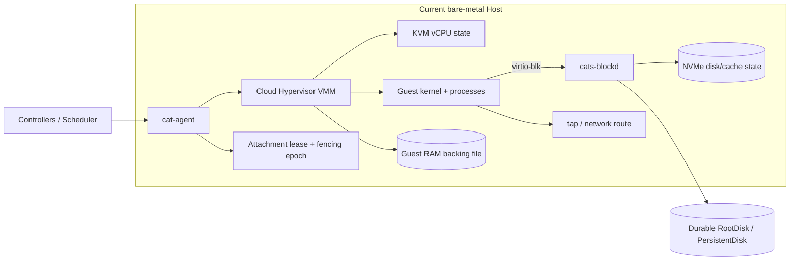

# Cats 睡眠、唤醒与 VMM 资源回收

> Agent 阅读约定（[ADR-0002](decisions/0002-lifecycle-states-running-suspended-warm-cold.md)）：`Suspended`（pause + page-out）保留 VMM 与原 Guest 进程，绑定原 Host；`Warm`（snapshot + VMM/backend exit）无常驻进程，进程状态保存在本地快照，同样绑定原 Host；`Cold` 丢弃 Guest RAM 并允许任意 Host fresh boot。不要把三者合并成一个模糊的“sleep”状态。

## 1. 最终结论

Cats 不应只有一种“睡眠”。一个机制无法同时满足保留进程、快速唤醒、跨 Host 和彻底释放资源。正确做法是把 Suspended、Warm 与 Cold 作为三个不同产品状态（命名与映射见 ADR-0002）。

**Suspended：保留 VMM，回收 CPU 和大部分物理 RAM**

VMM、KVM fd、设备后端、tap、Attachment lease 和本地 NVMe backing 继续存在。Guest 进程状态保留，必须在原 Host 上 resume。实测唤醒 P50 约 0.21–0.23 秒。

**Warm：退出 VMM，进程状态保留在本地快照**

Cloud Hypervisor 对已暂停的 VM 生成 memory/device snapshot 后退出，vhost-user backend 一并退出，无常驻进程（专属 runtime RSS = 0）。快照存放在本地 NVMe；唤醒时重建 runtime，新 VMM 以 userfaultfd 按需恢复。仍绑定原 Host，且要求相同 VMM 版本。本地 NVMe 实测唤醒 P50 约 0.38–0.40 秒。

**Cold：退出 VMM，释放全部运行时资源**

CPU、RAM、VMM、tap、设备进程和强制本地缓存全部释放。只保留远端 RootDisk/PersistentDisk 与控制面 metadata，之后在任意 Host fresh boot。

**VMM 只负责协调暂停/快照，不负责完整资源回收**

Cloud Hypervisor 停 vCPU、保存时钟、暂停设备并维护/导出 VM 状态。Guest sync、磁盘 FLUSH、RAM page-out、快照文件管理、NVMe 清理和路由变更由平台组件完成。

**自动策略：Running → Suspended → Warm → Cold**

短期闲置先 Suspended；继续闲置或 Host 内存/backing 压力升高时转 Warm；更久闲置、快照空间紧张或 Node drain 时转 Cold。Shell/流量触发单次 Wake，不能让同一个 Cat 并发启动两次。

**一句话：**Suspended 是“机器还在，只是 CPU 停了，RAM 被放到本地 NVMe”；Warm 是“机器壳退出了，进程状态冻结在本地快照里”；Cold 是“机器没了，只剩远端磁盘，下次重新开机”。

**重要限制：**Suspended 和 Warm 都不是跨 Host 持久状态。原 Host 永久损坏后，内存 backing file 与快照一起丢失；平台必须丢弃进程状态，改用远端 RootDisk 做 Cold Recovery。

## 2. 四个主要状态

```mermaid
stateDiagram-v2
    [*] --> Running
    Running --> Suspended: syncfs + local durability barrier + pause + page-out
    Suspended --> Running: resume + demand page fault
    Suspended --> Warm: snapshot + VMM/backend exit
    Warm --> Running: rebuild runtime + on-demand restore + resume
    Running --> Cold: durable FLUSH + VMM/backend exit + cleanup
    Suspended --> Cold: confirm durable generation + VMM/backend exit
    Warm --> Cold: discard snapshot + release runtime lease
    Cold --> Running: schedule + attach/fence + fresh boot
    Running --> Cold: Host lost; discard RAM; fence old epoch
    Suspended --> Cold: Host lost; discard RAM; fence old epoch
    Warm --> Cold: Host lost; snapshot lost; fence old epoch
```



| 状态 | 进程内存 | Host 绑定 | 恢复方式 | 适用时长 |
|----|----|----|----|----|
| Running | 保留且驻留 | 是 | 无需恢复 | 正在使用 |
| Suspended | 保留在本地内存 backing；多数页不驻留 | 是 | `resume`，工作集按需 fault | 分钟到较短小时级 |
| Warm | 保留在本地 NVMe 快照；无驻留进程 | 是 | 重建 runtime + 新 VMM on-demand restore + `resume` | 小时级到天级 |
| Cold | 不保留 | 否 | 新 VMM 从远端 RootDisk 启动 | 长期闲置 |

## 3. Running 时 Host 上有哪些资源

理解“回收了什么”，必须先明确运行时实际存在的对象。VMM 只是其中一个进程，磁盘 backend、网络和本地文件同样会占用资源。



说明：Guest RAM backing file 由 VMM 映射；它和 blockd 的 NVMe disk/cache state 是两类独立文件，但必须由同一个生命周期事务统一记账和回收。

**VMM 不是全部：**即使 VMM 已经暂停，cats-blockd、NVMe memory file、tap、lease 和 Node 路由仍可能存在。资源回收必须由一个跨组件 lifecycle transaction 完成，不能只观察 Cloud Hypervisor 状态。

## 4. Running → Suspended 的完整流程

Suspend 的正确顺序是“停止新活动 → Guest 落盘 → 远端持久点 → VMM pause → RAM page-out”。不能先停 Guest 再希望 Guest 自己执行 sync。

**1. 工作与状态门禁**

Cat generation 进入 Suspending；平台工作租约与 Guest 用户程序租约必须为空。Node 关闭 exec/proxy gate，Guest Agent 以 `PrepareSuspend(expected_lease_sequence)` 原子关闭 `/run/cats/runtime.sock` 的新 acquire/renew；阻止新的 exec、挂盘和部署；并发 wake/suspend singleflight。任一新工作使本次 Suspend 被拒绝并恢复 Running。

**2. Guest Quiesce**

Guest Agent 对 RootDisk/PersistentDisk 执行 syncfs；应用 hook 有严格 deadline。

**3. Local durability barrier**

cats-blockd 完成屏障前 Dirty Set，记录 local durable generation；失败则不进入
Suspended。Strict 此时也已经远端 durable；Relaxed 可以在 Host-bound 的
Suspended 状态继续由后台 publisher 推进 remote generation。

**4. VMM Pause**

Cloud Hypervisor 暂停 vCPU、保存时钟、暂停设备并进入 Paused。

**5. Memory Page-out**

cat-agent 对 Guest RAM mmap 执行 MADV_PAGEOUT，把大部分物理页写回/丢弃。

**6. 资源记账**

释放 vCPU run budget；更新 resident_bytes、NVMe backing bytes 和 resume commitment。

**7. 发布状态**

Cat=Suspended；Endpoint 按 wake_policy 返回唤醒响应或触发 Wake。

### 4.1 为什么先 sync/FLUSH

### Guest Page Cache

应用的 write 可能只修改 Guest Linux Page Cache。VMM pause 不会替 Guest 调用 sync，也不会让 ext4 自动产生 FLUSH。

- 先通过 Guest Agent 调用 syncfs
- 等待 virtio-blk 请求完成
- 普通未 fsync 写仍遵循 volatile cache 语义

### Host Block Cache

Guest 已发 FLUSH 后，Strict 要求对象和权威 Root 已提交；Relaxed 只承诺本地
immutable pack。Suspend 本来就是 Host-bound，可以记录本地水位后 pause；
Warm/Cold/Snapshot/Detach/迁移会删除或转移 Host 所有权，必须再 drain 到远端。

- Pending Commit Pack 固定提交输入
- 始终满足 `remote_generation <= local_generation`
- 只有 `remote_generation == local_generation` 才允许越过 Host 所有权边界

**fsfreeze 不是普通 Suspend 的必需步骤：**syncfs + 完成 FLUSH 后再 pause 已能形成一致运行状态。fsfreeze 更适合需要把文件系统与磁盘 Snapshot 精确对齐的场景；冻结后必须有 watchdog 保证 unfreeze。

## 5. Cloud Hypervisor Pause/Resume 内部顺序

Cloud Hypervisor 的 pause 不是简单对 VMM 进程发送 SIGSTOP。它按顺序协调 vCPU、Guest clock、Device Manager 和底层 Hypervisor 状态。

### 5.1 Pause 时序

| 步骤 | cat-agent | Cloud Hypervisor | KVM / vCPU | Device / blockd |
|---:|---|---|---|---|
| 1 | 调用 VM pause API | 验证 Running → Paused 转换 | 仍在运行 | 仍在处理队列 |
| 2 | 等待 | 激活 pending virtio devices | 仍在运行 | 避免半初始化设备进入 pause |
| 3 | 等待 | CPU Manager pause | 退出 `KVM_RUN`；停在 barrier | 完成已有事件 |
| 4 | 等待 | 捕获 Guest clock | 寄存器/时钟不再变化 | — |
| 5 | 等待 | Device Manager pause | 已停止 | virtio frontend / event processing 暂停 |
| 6 | 等待 | Hypervisor VM pause；`state=Paused` | KVM VM 保留但不执行 | blockd 可完成已开始的后台提交 |
| 7 | 收到成功 | API 返回 | 0 Guest CPU | socket/lease 保留 |

### 5.2 Pause 后 VMM 保留的状态

### CPU / KVM

- KVM VM fd
- 每个 vCPU fd
- 通用与系统寄存器
- 中断控制器状态
- vCPU thread 和同步 barrier

### 内存

- Guest Physical → VMM virtual mapping
- KVM memory slots
- 内存 backing file fd
- VMM 页表
- 已驻留物理页，直到 page-out

### 设备

- virtio feature negotiation
- queue index 与 eventfd
- PCI/MMIO 配置
- vhost-user socket
- tap、vsock 与 console 状态

**Pause 不等于资源释放：**它首先保证状态停止变化。暂停成功时，CPU 几乎不再消耗，但 Guest RAM RSS 通常仍和暂停前接近。物理内存回收是下一阶段。

## 6. Guest RAM 如何从物理内存回收到 NVMe

推荐每个 Cat 使用受控的 file-backed memory zone。Guest 看见的内存大小不变；Host 可以在暂停后回收其物理页，并在恢复访问时从本地 NVMe 按需读回。

```mermaid
sequenceDiagram
    participant A as cat-agent
    participant V as Cloud Hypervisor
    participant K as Host kernel
    participant F as NVMe RAM backing file

    A->>V: pause VM; confirm vCPU/device state stopped
    A->>K: process_madvise(MADV_PAGEOUT) on file-backed RAM VMAs
    K->>F: write dirty pages / retain file-backed contents
    K-->>A: reclaim physical page frames
    Note over V,F: VMM, mappings, KVM fds and backing file still exist
    A->>V: resume VM
    V->>K: Guest accesses a non-resident page
    K->>F: demand page-in
    F-->>V: restore page contents
```

### 6.1 Linux 实际行为

| 页面类型 | MADV_PAGEOUT 行为 | 结果 |
|----|----|----|
| file-backed dirty page | 写回 backing file | 写入本地 NVMe 后可从物理 RAM 回收 |
| file-backed clean page | 直接从 page cache 回收 | 下次访问从 backing file fault 回来 |
| anonymous page | 如果 Host 配置 swap，可换出 | 没有 swap 或不适用时可能不回收 |
| pinned / mlocked / 不适用页面 | 内核可以忽略 advice | 继续驻留，所以 page-out 是 best-effort |
| 从未触碰的 sparse page | 本来就没有物理页 | 既不占 RAM，也不占实际 NVMe block |

**配置要求：**如果使用匿名 Guest RAM 且 Host 没有 swap，pause 后内存可能基本不下降。Cats 应明确使用每 Cat 独立的 file-backed memory zone，并对 backing file 做权限、容量、生命周期和加密管理。

**不要使用不易回收的内存配置：**如果 Suspend 是核心能力，需要验证 hugetlbfs、显式 HugeTLB、mlock、vhost-user shared mapping 和 THP 对 page-out 的影响。不能只看配置项存在，必须测 pause 前后 RSS/PSS 与 refault。

## 7. Suspended 与 Warm 各回收了哪些资源

| 资源 | Running | Suspended | Warm | Cold | 谁执行回收 |
|----|----|----|----|----|----|
| vCPU 执行时间 | 持续消耗 | 基本完全回收 | 完全回收 | 完全回收 | Cloud Hypervisor CPU Manager / scheduler accounting |
| vCPU thread | 运行/KVM_RUN | 保留但阻塞 | 线程消失 | 线程消失 | VMM pause / VMM exit |
| Guest physical RAM | 工作集驻留 | 大部分 page-out | 全部释放；内容在快照中 | 全部释放 | cat-agent + Host memory manager / VMM exit |
| Guest 逻辑 RAM | 例如 8GiB | 仍是 8GiB | 唤醒承诺仍是 8GiB | 不存在 | Cold 时关闭 VMM |
| VMM / KVM fd | 存在 | 全部保留 | 全部释放 | 全部释放 | Cloud Hypervisor snapshot 后 exit / shutdown |
| cats-blockd | 读写 | 保留并续租 | 退出；唤醒时重建 | 停止 | cat-agent |
| Dirty/Pending Commit | 可能存在 | 提交前必须保留 | 进入 Warm 前必须为零 | 必须清零后才可清理 | cats-blockd Commit Engine |
| Disk clean cache | 保留热集 | 可按压力淘汰 | 可按压力淘汰 | 可全部删除 | NVMe Manager |
| Memory backing / snapshot | backing 存在 | backing 必须保留 | backing 删除；snapshot 必须保留 | 全部删除/密钥销毁 | cat-agent / NVMe Manager |
| tap / bridge / overlay | 存在 | 通常保留 | 删除；唤醒时重建 | 运行绑定清除 | Network Manager |
| Endpoint 名称 | active | sleeping/wakeable | sleeping/wakeable | unbound/wakeable | Route Controller |
| Host 亲和性 | 有 | 必须保留 | 必须保留（快照在本地） | 解除 | Scheduler / Cat Controller |
| Attachment / fencing epoch | active | 保留并续租 | 保留（唤醒时同 epoch 续租） | 释放；下次 attach 用更高 epoch | Disk Controller / cats-blockd |
| 远端 Root/PersistentDisk | 存在 | 存在 | 存在 | 存在 | Disk Controller |

### 7.1 一个 8GiB Cat 的示例

**8 GiB**Guest 可见逻辑 RAM，Suspend 前后不变

**≈5 GiB**假设运行时实际触碰并驻留的工作集

**几十～数百 MiB**page-out 后可能保留的 RSS；取决于 workload 和 pinned page

**≈5 GiB NVMe**示例 backing 实际 block；是 RAM 回收换来的本地盘成本

**不能把 Suspended 记成“0 内存资源”：**它只是在物理上低驻留，逻辑上随时可能恢复到完整 8GiB。调度器必须同时记录 resident bytes 和 resume commitment，否则大量 Cat 同时唤醒会让 Host OOM 或持续换页。

**Warm 把最后的驻留也清零：**Suspended 剩余的几十～数百 MiB VMM 驻留在 Warm 中一并释放，代价是唤醒要重建 tap/blockd/VMM 并从本地快照按需读回内存页（本地 NVMe 实测首次健康 P50 约 0.38–0.40 秒），且快照本身占用本地 NVMe 空间。

## 8. Suspended → Running 的唤醒过程

唤醒分为控制面激活、容量准入、VMM resume 和内存 refault。VMM resume 本身很短，但应用第一次访问冷内存会继续产生按需缺页。

**1. Wake 触发**

`cats shell/start/resume` 或允许 wake 的 Endpoint 请求到达；同一 Cat singleflight。

**2. 健康检查**

确认原 Node、VMM PID、API socket、blockd、lease epoch 和 memory backing 都存在。

**3. 容量准入**

检查 CPU run slot、Host memory headroom 和并发 refault 预算；必要时先 Cold 其他 Cat。

**4. VMM Resume**

恢复时钟、Hypervisor VM、Device Manager、vCPU，顺序不能反。

**5. RAM Refault**

Guest Kernel/进程访问冷页时从本地 NVMe 按需读回，不全量加载 Guest RAM。

**6. Ready**

Guest Agent 心跳、磁盘和基础健康检查通过；清理睡眠中的旧 session。

**7. Route Active**

发布新 activation epoch；等待中的 shell/HTTP 请求连接 Guest。

### 8.1 Cloud Hypervisor Resume 的实际顺序

步骤

Control / Agent

Cloud Hypervisor

Device

vCPU / Memory

1

调用 resume

验证 Paused → Running

暂停

暂停

2

等待

恢复 Guest clock

暂停

避免时间倒退/错误基线

3

等待

Hypervisor VM resume

准备恢复

KVM VM 可运行

4

等待

Device Manager resume

virtio queue / eventfd 恢复

仍未放行 Guest

5

等待

CPU Manager resume

已就绪

vCPU 重新进入 KVM_RUN

6

探测 Ready

state=Running

处理 Guest I/O

冷页按需 page fault

**唤醒延迟由两部分组成：**一是 VMM 控制动作延迟，通常很短；二是 workload refault 延迟，取决于 Guest 有多少冷页、NVMe 随机读和应用工作集。不能只用 `ch-remote resume` 命令耗时代表用户可用时间。

**网络连接：**Guest TCP 状态虽然还在 RAM 中，但远端客户端、NAT、LB 和防火墙可能已经超时。产品只能保证 Endpoint 名称恢复，不能保证休眠前的 TCP/WebSocket 连接继续可用。

## 8A. Suspended → Warm 与 Warm → Running

Warm 在 Suspended 的基础上退出 VMM 与设备后端，把进程状态固化到本地快照。

### 进入 Warm

1.  停止晚到写并强制 drain；确认所有卷
    `remote_generation == local_generation`。不能仅沿用进入 Suspended 时的
    本地水位。
2.  Cloud Hypervisor 对已暂停的 VM 生成 memory/device snapshot 到本地 NVMe，校验完整性并记录 VMM 版本。
3.  VMM 与 cats-blockd 退出；删除 memory backing file；清理 tap 与 socket。
4.  保留 Attachment/fencing epoch、Host 亲和与 Endpoint sleeping 状态；记账 snapshot bytes 与 resume commitment。

### Warm 唤醒

1.  Wake singleflight 与 Suspended 相同；先校验快照完整性和 VMM 版本匹配。
2.  容量准入：RAM headroom 与并发 restore 预算（与 Cold 同级的内存准入）。
3.  重建 tap、vsock、cgroup 与 cats-blockd（同一 attachment epoch 续租）。
4.  启动新 Cloud Hypervisor，userfaultfd on-demand restore，恢复顺序与 §8.1 相同。
5.  resume 后 demand fault 从本地 NVMe 快照读回；Guest Ready 后发布新 activation epoch。
6.  任一步失败：丢弃快照与半建 runtime，走 Cold fallback，不允许卡在 Restoring。

实测（单 Host、参考 vhost-user 后端，见 §15.1）：本地 NVMe 上重建 runtime 约 17–38 ms，restore API 约 25–32 ms，首次健康 P50 0.380–0.399 s；EBS 上同一路径的并发唤醒会退化到秒级，因此快照介质必须是本地 NVMe。

## 9. Running/Suspended/Warm → Cold：彻底资源回收

Cold 的目标是让 Cat 不再依赖原 Host。进入 Cold 前必须确保远端磁盘 durable；之后退出 VMM、停止设备 backend、清理本地资源（含快照）并撤销运行时 Attachment。

### 进入 Cold

1.  阻止新 exec、deploy、mount 和流量激活。
2.  如果还在 Running，Guest syncfs；Suspended 的 Guest 已冻结，Warm 已经越过强制 drain。
3.  对每卷强制 drain 到 `remote_generation == local_generation`；失败时保留
    blockd、pending、lease 和本地 runtime，状态保持可重试，不能继续 cleanup。
4.  Route 变为 unbound/cold。
5.  Cloud Hypervisor shutdown/exit（Warm 时 VMM 已不存在，跳过）。
6.  停止 cats-blockd，释放 runtime lease。
7.  删除 tap、socket、cgroup、memory backing、RAM snapshot 和本地 Secret。
8.  clean cache 进入立即可淘汰队列。

### Cold 唤醒

1.  Scheduler 选择任意健康 Node。
2.  创建更高 Attachment fencing epoch。
3.  启动空或复用 clean cache 的 cats-blockd。
4.  建立 tap、vsock、cgroup 和 VMM 配置。
5.  启动全新的 Cloud Hypervisor。
6.  Guest 从 RootDisk boot；ext4 journal recovery。
7.  Guest Agent Ready 后发布 route epoch。
8.  默认 Ubuntu Guest 的 systemd 重新启动 enabled user service；Guest Agent
    readiness 与 User Service readiness 分开报告（ADR-0023）。

### 9.1 VMM 退出后真正释放的内容

### KVM / CPU

- VM fd 和 vCPU fd 关闭
- vCPU thread 消失
- 寄存器/中断/时钟状态释放
- CPU cgroup allocation 释放
- 不保留 Guest process state

### Memory / Device

- Guest mmap 和 memory slots 删除
- VMM heap/stack 释放
- memory backing file 与 RAM snapshot 删除（密钥销毁）
- virtio frontend/eventfd/socket 关闭
- blockd 在 final FLUSH 后退出

### Network / Local State

- tap 与 per-Cat firewall 删除
- 运行 route binding 清除
- 本地 Secret 清除
- dirty/pending 必须为零
- clean disk cache 可全部淘汰

**Cold 的 Ground Truth：**只剩 PostgreSQL 中的 Cat/Disk/Endpoint 记录和对象存储中的 RootDisk/PersistentDisk。新 Host 不需要旧 Host 上的任何文件才能启动。

## 10. Warm 的边界：本机快照，不是跨 Host Hibernate

“把内存写成 Snapshot、退出 VMM、以后 restore”能同时释放 Host RAM 和保留进程——这正是 Warm 层（ADR-0002）做的事，但 V1 把它严格限制在同一台 Host、固定 VMM 版本和本地 NVMe 快照上。跨 Host 版本（快照上传对象存储、异地 restore）引入完整的 CPU/设备/网络/版本一致性问题，仍然排除在 V1 之外。

| 方案 | 保留进程 | 释放 VMM/RAM | 跨 Host | 复杂度与风险 |
|----|----|----|----|----|
| Pause + Page-out（Suspended） | 是 | 保留 VMM；大部分 RAM 可回收 | 否 | 最低；依赖本地 NVMe 和原 Host |
| Snapshot + VMM exit（Warm，V1） | 是 | VMM 退出；RAM 全部释放；快照占本地 NVMe | 否 | 中；需 VMM 版本 pin、设备状态对齐、快照加密与完整性校验 |
| Cold fresh boot | 否 | 全部释放 | 是 | 低；只依赖成熟磁盘恢复 |
| Hibernate Snapshot/Restore（未来） | 理论上是 | 退出后可全部释放 | 理论上是 | 高；必须迁移 CPU、RAM、时钟、设备 backend 和网络状态 |

下列风险对本机 Warm 也部分适用（是 Warm 实现必须处理的约束），对跨 Host Hibernate 则是阻断项：

### 数据量

8GiB Guest 可能产生数 GiB 内存 Snapshot。即使按 dirty page/压缩优化，写入 NVMe/对象存储仍有显著延迟和成本。

### 设备一致性

vhost-user-blk 的 queue、in-flight request、interrupt、socket 和 cats-blockd transaction 必须与 VMM snapshot 对齐。

### 版本兼容

Cloud Hypervisor 不保证 Snapshot/restore 跨版本兼容。Node 滚动升级会与长期 Hibernate Snapshot 冲突。

### 网络语义

Guest TCP 状态恢复不代表 NAT、LB 和对端连接还存在。旧 vsock session 也必须丢弃重建。

### 磁盘原子点

内存 Snapshot 必须引用明确的 disk durable generation；否则 RAM 中的文件系统状态与远端盘版本不匹配。

### 安全

Snapshot 包含应用密钥和进程内存，必须独立加密、授权、保留和安全删除，不能当普通 cache。

**决策（ADR-0002，取代本文旧版“V1 只有两层”的结论）：**V1 支持同 Host 的 Suspended（pause + page-out）、同 Host 的 Warm（snapshot + VMM/backend exit，本地 NVMe 快照、版本 pin）与跨 Host 的 Cold fresh boot。跨 Host Hibernate 只有在精确 Cloud Hypervisor + cats-blockd 版本完成 crash、migration、device 和安全验证后再加入。Warm 上生产前必须先用 cats-blockd 复验快照的设备状态对齐（现有数据来自参考 vhost-user 后端）。

## 11. 容量记账与自动分层

Suspend 的物理 RSS 很低，但它仍是一笔可恢复内存承诺和本地 NVMe 消耗。调度器不能只用当前 RSS 做 placement。

### 11.1 每个 Suspended/Warm Cat 的记账数字

``` code-block
SuspendedResource {
  logical_guest_memory_bytes   # Guest 配置内存，例如 8GiB
  resident_memory_bytes        # page-out 后当前 Host RSS/PSS
  memory_backing_bytes         # 本地 NVMe 实际占用
  resume_commit_bytes          # 同时唤醒时可能恢复的内存承诺
}

WarmResource {
  logical_guest_memory_bytes   # Guest 配置内存
  snapshot_nvme_bytes          # 本地快照实际占用
  resume_commit_bytes          # 唤醒时的内存准入承诺（RAM 无驻留）
  vmm_version                  # 快照绑定的 Cloud Hypervisor 版本
}

NodePressure {
  running_resident_bytes
  suspended_resident_bytes
  suspended_resume_commit_bytes
  warm_resume_commit_bytes
  memory_backing_nvme_bytes
  warm_snapshot_nvme_bytes
  disk_dirty_and_pending_bytes
  clean_cache_bytes
  resume_concurrency
}
```

### 11.2 为什么会出现“逻辑 1.6TiB，物理 512GiB”

如果一个 Node 上有 200 个 8GiB Suspended Cat，它们的逻辑可恢复内存是 1.6TiB。即使当前 RSS 总和只有几十 GiB，也绝不能让 200 个 Cat 同时 resume。需要 overcommit 上限、并发唤醒限流和 Warm/Cold 降级。Warm Cat 的 RAM 驻留为零，但唤醒承诺同样是完整逻辑内存，且快照占用本地 NVMe；它必须与 Suspended 一起纳入 resume commitment 与快照空间水位。

| 水位 | 动作 | 目的 |
|----|----|----|
| RAM 低压 | 允许 Running → Suspended；正常 page-out | 降低闲置计算成本 |
| RAM 高水位 | 加速 oldest Suspended page-out；限制同时 Resume | 避免 Host reclaim 风暴和 OOM |
| NVMe memory backing 高水位 | 把最老、低优先级 Suspended Cat 转 Warm（释放 backing，改占快照空间）或直接 Cold | 释放真正的本地盘空间 |
| NVMe snapshot 高水位 | 把最老、低优先级 Warm Cat 转 Cold，删除快照 | 快照不是无限期本地缓存 |
| Dirty/Pending 高水位 | 停止新的 Suspend/Warm/Cold；先回压 Guest 写并完成提交 | 不能删除唯一未提交数据 |
| 用户请求 Wake 无 headroom | 短队列；优先 Cold 其他低优先级 Cat；超时返回明确错误 | 不能直接 resume 导致整机抖动 |
| Node drain | Suspended/Warm Cat 不能 live 搬迁，先转 Cold，再在其他 Node fresh boot | 解除 Host 亲和 |

### 11.3 自动策略

当前 V1 控制面在工作驱动的立即 Suspended 之后，使用持久化的
`observed_state_since_ms` 继续降级：稳定 Suspended 默认 10 分钟后转 Warm，稳定 Warm
默认 24 小时后转 Cold。阈值分别由 `CATS_AUTO_WARM_AFTER_SECONDS` 和
`CATS_AUTO_COLD_AFTER_SECONDS` 配置，`0` 表示关闭对应边界。每次晋级都在事务中重新
检查 policy、desired/observed、状态时间和活跃工作租约；控制面重启与重复心跳不会
重置计时。

``` code-block
if cat.running and idle_for > suspend_after:
    suspend(cat)                        # pause + page-out

if cat.suspended and (
       idle_for > warm_after
    or node.memory_pressure > high
    or node.memory_backing_pressure > high):
    warm_stop(cat)                      # snapshot + VMM/backend exit

if (cat.suspended or cat.warm) and (
       idle_for > cold_after
    or node.snapshot_pressure > high
    or node.draining):
    cold_stop(cat)

if wake_requested(cat):
    if cat.state == Suspended and original_node_healthy:
        admit_resume_or_queue(cat)
    elif cat.state == Warm and original_node_healthy \
            and snapshot_valid(cat) and vmm_version_matches(cat):
        admit_restore_or_queue(cat)
    else:
        cold_start_on_new_node(cat)
```

## 12. 故障、取消与竞态

睡醒涉及 Guest、VMM、blockd、Node 与控制面，必须把每个中间点定义成可恢复阶段。不能只保存一个布尔值 `sleeping=true`。

| 故障点 | 正确状态 | 恢复动作 |
|----|----|----|
| Guest sync 超时 | 保持 Running 或标记 SuspendFailed | 不强行宣称 durable；按策略重试或执行受控 Cold shutdown |
| 本地 durability barrier 失败 | 不进入 Suspended | 保留 Guest/runtime；本地 fsync/ENOSPC 恢复后重试 |
| 强制 remote drain 失败 | 不进入 Warm/Cold，不创建 Snapshot，不 Detach/迁移 | 保留 blockd、pending、lease 与源 runtime；对象/DB 恢复后同一 job 重试 |
| vCPU 已 pause，Device pause 失败 | VM 处于 Pausing/Error | 优先尝试 resume 回 Running；不执行 page-out 或 cleanup |
| Pause 成功，Page-out 部分失败 | 可以保持 Suspended，但记录低回收率 | page-out 是 best-effort；稍后重试；持续高 RSS 则转 Cold |
| Page-out 过程中收到 Wake | 相同 Cat lifecycle generation 仲裁 | 取消后续 page-out，等待当前 syscall 返回，再 resume |
| VMM 在 Suspended 时崩溃 | 进程状态丢失；不可只靠 memory file restore | Fence 旧 runtime，按 Cold Recovery fresh boot |
| 整台 Host 丢失 | Suspended memory 视为丢失 | 云 fencing/Node lease 确认；新 Host 获取更高 disk epoch；Cold start |
| Resume 后 Guest Agent 未 Ready | Resuming 超时 | 收集 console/VMM/device 指标；一次 resume 修复失败后 Cold reboot |
| Warm snapshot 损坏、丢失或 VMM 版本不匹配 | 不进入 Restoring；标记 WarmInvalid | 丢弃快照与本地状态，按 Cold Recovery fresh boot |
| Warm restore 中途失败（restore API/resume 错误） | Restoring 超时/错误 | 清理半建 VMM/tap/backend；最多重试一次后 Cold fallback |
| Cold cleanup 中控制面重试 | Job 幂等 | 按明确路径和 PID identity 重做；不存在视为已清理 |
| 旧 Route cache | Node 再检查 activation epoch | 旧 epoch 返回 409/503，不代理到错误 Guest |

### 12.1 状态机建议

``` code-block
Running
  → SuspendRequested
  → QuiescingGuest
  → FlushingDisks
  → PausingVmm
  → PagingOutMemory
  → Suspended

Suspended
  → ResumeRequested
  → AdmittingResources
  → ResumingVmm
  → WaitingGuestReady
  → Running

Suspended
  → WarmRequested
  → VerifyingDurableGeneration
  → SnapshottingVmm
  → StoppingVmmAndBackend
  → Warm

Warm
  → ResumeRequested
  → AdmittingResources
  → RebuildingRuntime          # tap / blockd / cgroup
  → RestoringVmm               # userfaultfd on-demand restore
  → WaitingGuestReady
  → Running

Running | Suspended | Warm
  → ColdStopRequested
  → FlushingDisks              # 强制 remote_generation == local_generation
  → StoppingVmm                # Warm 时 VMM 已不存在，跳过
  → ReleasingAttachment
  → CleaningLocalState         # 含 memory backing 与 RAM snapshot
  → Cold

# 每个 transition 带 cat_generation、operation_id 和 deadline。
# Node Job key = cat_id / generation / action，重复请求返回原结果。
# Warm restore 任一阶段失败 → ColdStopRequested，不允许停留在 Restoring。
```

**禁止操作：**不能在 `remote_generation < local_generation` 时删除 pending/local
runtime 或释放 lease；不能在旧 VMM 可能继续运行时给新 Host 发相同 Attachment
epoch；不能把 page-out 失败误认为 Cold；不能仅凭控制面状态删除 Host 上未知
PID。

## 13. Cats 中的模块职责

| 模块 | Suspend 职责 | Resume/Cold 职责 |
|----|----|----|
| Cat Controller | 决定 desired state、创建 Operation、阶段超时和重试 | singleflight Wake、故障降级、Cold Recovery |
| Scheduler | 释放/调整 CPU run budget，记录 resume commitment | Resume 容量准入；Cold 时重新选 Node |
| cat-agent | Guest sync、调用 CH pause、pidfd/process_madvise、状态检查 | 调用 resume 或 shutdown；进程、tap、socket、cgroup cleanup |
| Cloud Hypervisor | 暂停 vCPU/clock/device/hypervisor VM | 按序恢复；Cold 时退出并释放 KVM 状态 |
| Guest Agent | `/run/cats/runtime.sock` HTTP 工作租约、sequence/quiesce fence、syncfs、应用 hook、磁盘/服务状态报告 | Ready、重新开放租约 admission、session 重建、Cold boot 后 mount/resize 检查 |
| cats-blockd | 完成本地 barrier，保留 lease/backend，后台推进 remote generation | Resume 继续；Warm/Cold/Snapshot/Detach final drain 成功后才释放 lease；新 Host 使用新 epoch |
| NVMe Manager | memory backing quota、page-out 统计、clean cache 淘汰 | Cold 删除 backing 和 staging；密钥清理；Wake 可选预热 |
| Route Controller | active → sleeping，应用 wake_policy | Wake singleflight；Ready 后发布新 activation epoch |
| Node Controller | 观察内存/NVMe 水位，触发自动分层 | Node Lost、cordon/drain 与批量恢复限流 |

Warm 新增职责：cat-agent 负责 snapshot/restore 调用、快照完整性校验与删除；NVMe Manager 管理快照配额、水位与加密清理；Scheduler 把 Warm 记为“0 RAM 驻留 + snapshot bytes + resume commitment + Host 亲和”；cats-blockd 在进入 Warm 前完成 final commit 并退出，唤醒时以同一 epoch 重建续租；Route Controller 的 sleeping/wake 行为与 Suspended 相同。

### 13.1 Node 侧伪代码

``` code-block
async fn suspend_cat(job: SuspendJob) -> Result<SuspendResult> {
    verify_generation_and_pid_identity(job)?;
    session_gate.block_new_sessions(job.cat_id).await?;

    guest.sync_filesystems(job.deadline).await?;
    let local = blockd.flush_all_local(job.attachment_epochs).await?;

    ch.pause(job.api_socket).await?;
    verify_vmm_state(job.api_socket, "Paused").await?;

    let ranges = discover_guest_memory_mappings(job.vmm_pidfd)?;
    let before = read_memory_accounting(job.vmm_pid)?;
    let advised = process_madvise_pageout(job.vmm_pidfd, ranges)?;
    let after = wait_for_reclaim_or_deadline(job.vmm_pid, job.reclaim_target).await;

    persist_observation(Suspended {
        local_durable_generation: local,
        remote_durable_generation: blockd.remote_watermarks(),
        advised_bytes: advised,
        resident_bytes: after.rss,
        backing_bytes: stat_blocks(job.memory_backing),
    }).await?;
}

async fn resume_cat(job: ResumeJob) -> Result<()> {
    verify_same_node_runtime(job)?;
    scheduler.admit_resume(job.cat_id).await?;
    verify_blockd_and_lease(job.attachment_epochs).await?;
    ch.resume(job.api_socket).await?;
    guest.wait_ready(job.deadline).await?;
    route.publish_new_activation_epoch(job.cat_id).await?;
}
```

**权限：**`process_madvise` 操作另一个进程需要 pidfd、ptrace 访问检查和 `CAP_SYS_NICE`。不要给整个 cat-agent 无限制 root；可以把 memory-reclaimer 拆成只允许操作已登记 VMM PID/range 的小型特权 helper。

## 14. 必须采集的指标

睡眠是否有效，不能只看状态变成 Suspended。必须同时证明 CPU 降低、RAM
回收、NVMe 成本可控、磁盘水位与积压可解释、唤醒按时成功。

| 类别 | 指标 | 用途 |
|----|----|----|
| Lifecycle | `suspend_duration`、`warm_stop_duration`、`resume_duration`、`warm_restore_duration`、`cold_start_duration`、阶段耗时、失败原因 | 区分 Guest sync、FLUSH、VMM、page-out、snapshot/restore、Ready 的瓶颈 |
| CPU | VMM CPU seconds、vCPU thread state、KVM exits、paused duration | 证明暂停后接近 0 CPU |
| Memory | logical、RSS、PSS、anonymous/file、advised bytes、reclaimed bytes、major/minor faults | 证明 page-out 效果和 Resume refault 成本 |
| NVMe | memory backing 与 RAM snapshot 的 logical/allocated bytes、写入/读取带宽、latency、quota、水位 | 量化“RAM 换 NVMe”的真实成本 |
| Storage | local/remote generation、unpublished generations/bytes/oldest age、local/remote FLUSH latency、allocated/accounted/max local bytes、eviction、backpressure、publish error、lease epoch/fenced | Suspend 证明本地 barrier；Warm/Cold/Snapshot/Detach 证明 `R == L`；暴露实际 Host-loss RPO |
| VMM/Device | pause/resume result、device pause latency、socket state、eventfd errors | 发现 vhost-user/virtio 恢复问题 |
| Wake | queue time、admission reject、first shell、first HTTP、working-set refault bytes | 用户实际体验而不只是 VMM API 时间 |
| Capacity | suspended count、resume commitment、overcommit ratio、concurrent wake、Cold demotion | 防止批量唤醒引发 OOM/抖动 |

### 14.1 推荐事件时间线

``` code-block
CatSuspendRequested
GuestQuiesceStarted / Completed
DiskFlushStarted / Durable { generation, epoch }
VmmPauseStarted / Completed
MemoryPageoutCompleted { before_rss, after_rss, advised_bytes, backing_bytes }
CatSuspended

CatWarmRequested
VmmSnapshotStarted / Completed { snapshot_bytes, vmm_version }
RuntimeExited { vmm, blockd, tap }
CatWarm

CatWakeRequested { source: shell | endpoint | user | scheduler }
ResumeAdmitted | RestoreAdmitted
RuntimeRebuilt                      # Warm only
VmmResumeCompleted | VmmRestoreCompleted
GuestReady
RouteActivated { activation_epoch }
CatRunning
```

## 15. 验收测试

需要在真实裸金属、真实 KVM、真实 cats-blockd 和真实 NVMe 上验证。只 mock Cloud Hypervisor API 无法发现 pinned page、virtqueue、时钟和 refault 问题。

### 正确性

- Guest 内计数器/进程在 Suspend/Warm 后继续
- Root/PersistentDisk digest 一致
- fsync 文件 Host crash 后恢复
- 未 fsync 数据允许按语义丢失
- Guest clock 不倒退
- 旧 session/route epoch 被拒绝
- Warm 快照校验失败必须走 Cold，不得部分恢复

### 资源回收

- pause 后 vCPU CPU≈0
- 8GiB 多种工作集 RSS 回收率
- memory backing 实际 block
- pinned/hugepage 对照组
- clean cache 淘汰与 dirty 保留
- Cold 后 PID/fd/tap/cgroup=0

### 唤醒性能

- VMM resume P50/P99
- Guest Ready / shell ready
- HTTP first byte
- NVMe refault bytes/latency
- 1/10/100 Cat 并发 Wake
- 内存压力下 admission 行为

### 故障注入

- FLUSH 各阶段 kill -9
- vCPU pause 后 device pause 失败
- page-out 中 wake
- Suspended VMM crash
- Warm 快照损坏 / VMM 版本不匹配 / restore 中途 kill
- 整台 Host power off
- 旧 Host 恢复网络尝试写

### 长时间稳定性

- 72h Suspend/Resume 循环
- memory backing 泄漏
- fd/tap/cgroup 泄漏
- RSS 回收退化
- 网络连接与 DNS 恢复
- Node drain 全流程

### 上线门槛

- 无成功 FLUSH 数据丢失
- 无双 Attachment writer
- 无 Host OOM
- 无 VMM/device resume hang
- Cold 不依赖旧 Host 文件
- 每个失败阶段可自动收敛

### 15.1 已有实验结论

2026-07-21 的 i4i.metal 正式实验使用 file-backed Guest RAM、Cloud Hypervisor v53 和 vhost-user-blk：

- 512 MiB、1 GiB、2 GiB Guest 的 pause + page-out（Suspended）唤醒 P50 为 0.212–0.231 秒。
- 暂停态 cgroup 物理内存 P50 为 6.941、11.635、17.336 MiB，回收比例 P50 为 97.706%–98.508%。
- 所有 30 个 page-out 样本均保持原进程 UUID。
- Snapshot + VMM/backend exit（Warm）从本地 NVMe 恢复的首次健康 P50 为 0.380–0.399 秒。
- 这些是单 Host 机制数据，不证明跨 Host memory restore，也不是生产 P99；Warm 数据使用 Cloud Hypervisor 自带参考 vhost-user 后端，尚未用 `cats-blockd` 验证快照的设备状态对齐（ADR-0002 待验证项）。

完整口径、CSV 和限制见[存储与生命周期实验总报告](experiments-2026-07-21-storage-lifecycle.md)和 [i4i lifecycle 报告](../experiments/warm-snapshot-benchmark/results/i4i-lifecycle-modes-20260721/README.md)。

## 16. 参考资料与相关设计

- [Cloud Hypervisor VM pause/resume source](https://github.com/cloud-hypervisor/cloud-hypervisor/blob/main/vmm/src/vm.rs)
- [Cloud Hypervisor commands](https://www.cloudhypervisor.org/docs/prologue/commands/)
- [`process_madvise(2)`](https://www.man7.org/linux/man-pages/man2/process_madvise.2.html)
- [`madvise(2)` / `MADV_PAGEOUT`](https://man7.org/linux/man-pages/man2/madvise.2.html)
- [KVM userspace memory API](https://docs.kernel.org/5.15/virt/kvm/api.html)
- [Cloud Hypervisor snapshot/migration status](https://github.com/cloud-hypervisor/cloud-hypervisor)
- [ADR-0002：生命周期四态](decisions/0002-lifecycle-states-running-suspended-warm-cold.md)
- [Cats 完整产品与技术架构](cats-complete-product-technical-architecture.md)
- [Direct-S3 ChunkStore（已选定后端，ADR-0003）](direct-s3-chunkstore-architecture.md)
- [Cats 存储产品蓝图（历史参考）](cats-storage-product-blueprint.md)
- [正式实验总报告](experiments-2026-07-21-storage-lifecycle.md)
