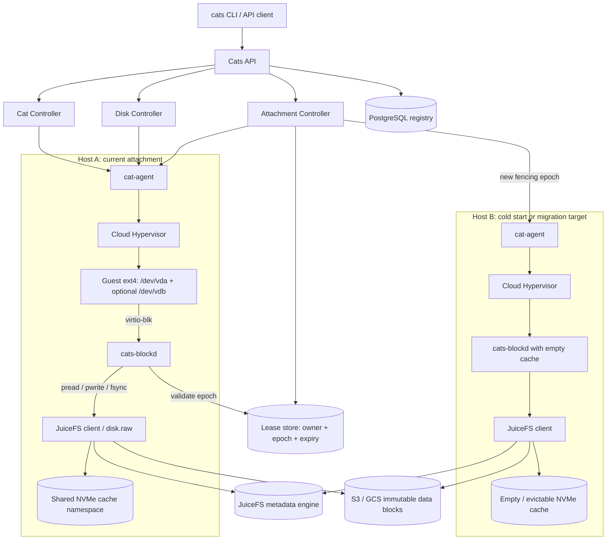

# Cats 存储架构设计（JuiceFS 方案，历史参考）

> **状态（2026-07-21）：本文描述的 JuiceFS-backed `disk.raw` 方案已按 [ADR-0003](decisions/0003-direct-s3-chunkstore-backend.md) 决定不实现**，仅作历史参考与需求出处。当前存储基线见 [Direct-S3 ChunkStore（Direct-OS 实现）详细设计](direct-s3-chunkstore-architecture.md)。
>
> Agent 阅读约定：不得实现或混用本文的远端格式。仍然有效并已并入基线文档的是产品层语义：Guest ext4、virtio-blk、vhost-user-blk、cats-blockd、RootDisk/PersistentDisk、RWO lease 和 FLUSH durability。

## 1. 架构决策

下面四项是本文后续设计的前提，不再同时保留多套主方案。

**Guest 磁盘接口：virtio-blk + ext4**

RootDisk 在 Guest 中是 `/dev/vda`，PersistentDisk 是额外的 virtio-blk 设备。Guest 不安装 JuiceFS，也不持有对象存储凭证。

**Host 磁盘后端：cats-blockd + vhost-user-blk**

Cloud Hypervisor 通过 Unix socket 把 virtio-blk 队列交给 `cats-blockd`。所有块 I/O 都经过该服务，因此可以执行 RWO fencing、FLUSH、容量控制和故障隔离。

**远端存储格式：JuiceFS 内部的 sparse raw file**

每块托管盘对应 JuiceFS 内部文件 `/volumes/<disk-id>/disk.raw`。该文件包含完整 ext4 逻辑扇区；JuiceFS负责 slice/block、元数据和对象存储。

**本地层：Host NVMe 只做可回收缓存**

每个 active attachment 有独立 cache namespace 和容量上限。Cold/detach 后释放 reservation；缓存可以立即删除，也可以作为无保证的可淘汰副本保留。

| 属性 | RootDisk | PersistentDisk |
|----|----|----|
| 是否必需 | 每个 Cat 必须有一块 | 可选，第一版最多一块 |
| 所有者 | Cat | Tenant / User |
| Guest 挂载 | `/dev/vda → ext4 → /` | `/dev/vdb → ext4 → /data`（路径可配置） |
| 访问模式 | RWO，只能由所属 Cat 使用 | RWO，同一时刻只能挂一个 Cat；可先 detach 再挂到另一个 Cat |
| Cat cold / migrate | 磁盘保留，释放本地缓存后可在新 Host lazy restore | MountBinding 保留，运行时 Attachment 与 lease 释放；启动时重建 |
| Cat destroy | 自动删除 | 自动安全 detach，磁盘继续存在 |
| 扩容 | 支持 grow | 支持 grow；第一版要求 detach 后扩容 |

## 2. 完整架构图

绿色实线是 Guest 文件 I/O；蓝色虚线是控制命令；紫色点线是元数据或 lease 访问。Host B 表示 cold start 或跨 Host 迁移后的目标节点。



块数据 I/O控制命令元数据 / lease

## 3. 关键模块

下表描述每个模块的职责边界。任何对象存储凭证和 JuiceFS 元数据地址都只存在于 Host 侧模块。

Control plane

### Cats API

对外提供 Cat 与 Disk 资源 API；不返回 bucket、metadata URL、cache path 或 JuiceFS 参数。

- 认证与租户隔离
- 命令幂等键
- 资源状态查询

Control plane

### Disk Controller

创建和管理 JuiceFS 内部的 `disk.raw`；实际存储操作以下发给 cat-agent 的幂等 StorageJob 执行。

- RootDisk：从 `golden-root.raw` 执行 `juicefs clone`
- PersistentDisk：`ftruncate` 创建 sparse file，`mkfs.ext4 -F` 格式化并记录 UUID
- 扩容、逻辑删除和后台 GC

Control plane

### Attachment Controller

实现 RWO，不允许同一磁盘同时挂到两个 Cat。

- MountBinding 保存 Disk、Cat 和 Guest 路径，跨 Cold 保留
- Attachment 只表示节点上的运行时挂载
- 发放单调递增 fencing epoch
- lease 到期、转移与审计

Node

### cat-agent

节点上的唯一执行入口；把控制面的期望状态转换成 Host 进程和 Cloud Hypervisor 设备。

- 启动/停止 JFS mount 与 blockd
- 调用 Cloud Hypervisor add/remove/resize disk
- 调用 Guest Agent mount/unmount/sync

Node

### cats-blockd

每个 active attachment 一个进程或隔离实例，向 Cloud Hypervisor 提供 vhost-user-blk。

- 把 LBA 请求转换为 disk.raw 的 pread/pwrite
- FLUSH → fsync；DISCARD → fallocate(PUNCH_HOLE)
- 不允许请求跨过 FLUSH 重排
- 持续续租；无法确认 lease 时停止写入
- 导出 IOPS、延迟、错误和 epoch

Node

### JFS Mount Manager

挂载平台内部 JuiceFS namespace，给 blockd 提供 raw file。

- 为 active disk 使用隔离 cache namespace
- 管理 metadata/object 凭证
- 观察 upload/compaction/GC 状态

Node

### NVMe Cache Manager

管理节点共享 NVMe 的干净读缓存，而不是给每个 Cat 预留一块固定 100GB 盘。

- active disk cache quota
- 按热度 LRU 淘汰
- Cold/detach 后释放 reservation
- 水位、回压和租户配额

Guest

### Guest Agent

只处理标准 Linux 磁盘，不知道 JuiceFS。

- 按 filesystem UUID 识别设备
- mount/unmount、syncfs、fsfreeze
- 扩容后的 rescan 与 resize2fs
- 向 cat-agent 返回挂载状态

Durable services

### JuiceFS + Object Store

JuiceFS 元数据引擎保存 disk.raw 的 file/slice/block 映射，对象存储保存不可变数据块。

- 生产配置使用至少 3 节点 TiKV；Cats Registry 使用 PostgreSQL
- 对象先上传，再提交可见元数据
- 随机写产生的 stale slices 由 compaction/GC 处理

## 4. 数据路径

### 4.1 读路径

应用 read()Guest

→

ext4 读取 LBA/dev/vda 或 vdb

→

virtio-blk requestCloud Hypervisor

→

cats-blockd preaddisk.raw offset

JuiceFS page/cache hit直接返回

或

JFS metadata lookupoffset → slice/block

→

对象存储 GET只获取被读到的 block

→

写入 NVMe cache返回 Guest，并供后续命中

### 4.2 写路径与 FLUSH

应用 write()Guest page cache

→

ext4 journal/data块写请求

→

cats-blockd pwritedisk.raw offset

→

JuiceFS slice/block对象 + 元数据

**默认持久性：**磁盘镜像挂载默认不启用不受保护的 JuiceFS client writeback。Guest 发出 FLUSH/fsync 后，`cats-blockd` 对 `disk.raw` 执行 fsync，只有 JuiceFS 完成数据对象上传并提交相应元数据后才向 Guest 返回成功。普通未 fsync 的数据仍可按 POSIX 语义在 Host 故障时丢失。

**写放大风险：**ext4 的 4KiB 随机写会落到一个大型 JuiceFS 文件中，形成多个 slice。JuiceFS 会后台 compact，但系统盘工作负载可能产生明显对象 PUT、compaction 和 stale-slice 成本。必须用 git clone、apt/npm install、Docker layer、SQLite fsync 和随机写压测决定是否需要自研更细粒度 block map。

### 4.3 100GB 逻辑盘里有 10 万个小文件时，实际上传什么

### 进入 JuiceFS 的数据

- 文件内容对应的 ext4 数据块
- inode、目录、位图、extent tree 等 ext4 元数据块
- ext4 journal 写过的块
- 这些块在 `disk.raw` 中对应的非空 byte ranges
- JuiceFS 保存上述 ranges 的 slice/block 映射

### 不会上传的数据

- 不会 dump Host 上整块 NVMe
- 不会上传 `disk.raw` 中从未写过的 100GB 空洞
- 不会把每个 Guest 小文件变成一个对象存储对象
- 不会依赖小文件在物理 NVMe 上是否连续

**结论：**cats-blockd 只按 Guest 实际写到的 LBA 更新 `disk.raw`。100GB 是逻辑地址空间；如果 10 万个文件总内容为 100MB，远端存量大致是“实际改写的 ext4 数据和元数据 + JuiceFS 块取整 + journal/覆写/compaction 放大”，而不是 100GB。具体放大量必须用真实工作负载测量。

## 5. 生命周期

所有流程都以控制面状态机驱动。CLI 成功返回之前，相应步骤必须达到明确的远端持久点或 Guest 挂载点。

**创建 Cat**`cats create dev`

**1. 创建资源**

建立 Cat 和 RootDisk；如果命令带可选盘参数，同时创建 PersistentDisk 和 MountBinding。

**2. 克隆模板**

`juicefs clone golden-root.raw root.raw`，只复制元数据引用。

**3. 获取 lease**

创建 RootDisk attachment 与 epoch。

**4. 启动数据面**

JFS mount → blockd → Cloud Hypervisor。

**5. Guest Ready**

ext4 根盘挂载，Guest Agent 和应用就绪。

**动态挂载**`cats mount disk --cat dev`

**1. 检查 RWO**

磁盘不能绑定或挂载在其他 Cat；否则拒绝。

**2. 创建绑定与 attachment**

保存 MountBinding；运行时状态 Attaching，发放新 epoch。

**3. 启动 blockd**

打开该 disk.raw 并续租。

**4. Hotplug**

Cloud Hypervisor add-disk；Guest 出现新设备。

**5. Guest mount**

按 filesystem UUID 挂载到用户指定路径。

**安全卸载**`cats unmount disk --cat dev`

**1. Guest unmount**

Guest Agent 执行 syncfs/umount；路径 busy 时拒绝继续。

**2. Flush**

blockd 把最后的 FLUSH 传播到 JuiceFS 持久点。

**3. Hot-unplug**

Cloud Hypervisor remove-disk，Guest 设备消失。

**4. 停止数据面**

停止 blockd，释放 lease 和 NVMe cache reservation。

**5. 解除绑定**

删除 MountBinding，PersistentDisk 回到 Available。

**Cold / 迁移**释放 Host A，在 Host B 启动

**1. Quiesce**

停止新任务，Guest syncfs/fsfreeze。

**2. Flush**

blockd FLUSH；确认 JFS 对象与元数据持久。

**3. Stop & fence**

停止 VMM/blockd，释放 Host A lease 和 cache reservation；MountBinding 继续保留。

**4. Host B attach**

获取更高 epoch，建立空 cache 和新 blockd。

**5. Lazy boot**

重新 boot；JuiceFS只下载启动和工作集读到的数据。

**销毁 Cat**`cats destroy dev`

**1. 停止应用**

阻止新写，开始终止流程。

**2. 外挂盘 detach**

umount → FLUSH → remove-disk；PersistentDisk 回到 Available。

**3. RootDisk flush**

完成最后一次远端提交并停止数据面。

**4. RootDisk 删除**

删除访问入口与元数据记录，进入 Deleting。

**5. 异步 GC**

JuiceFS回收不再引用的数据块；PersistentDisk 不受影响。

**Cold 的定义：**Cold 不保留 Guest 内存状态。VMM、CPU、RAM、运行时 Attachment lease 和专属 NVMe reservation 都释放；RootDisk 与 PersistentDisk 的 MountBinding 保留。下次重新 boot 时，控制面建立新的 Attachment，并从远端磁盘 lazy load。如果以后需要保留进程内存，应单独定义 Suspend 层，并为内存快照承担额外存储与恢复成本。

## 6. RWO、lease 与故障处理

### 为什么数据库里的 attached=true 不够

旧 Host 可能与控制面失联但仍能访问对象存储。如果新 Host 只修改数据库后直接挂载，就会出现两个 ext4 writer，导致文件系统损坏。

- 每次 attach 分配单调递增 epoch
- cats-blockd 必须持续续租
- 续租失败或无法联系 Lease Store 时停止接受新写
- 新 Host 等旧 lease 到期后才启动写路径

### Host 突然宕机

新 Host 从 JuiceFS 中同一个 disk.raw 恢复。已成功完成 Guest fsync 的数据应存在于对象存储和 JFS 元数据中；未 fsync 数据可能丢失。

- 等待或主动 fence 旧 epoch
- 新 Host 获取 attachment
- 启动空 cache 的 JFS client 与 blockd
- ext4 journal recovery / 必要时只读 fsck
- 校验成功后再对外 Ready

Disk: Available→ cats mount Disk: Bound@Cat→ cats unmount / destroy Disk: Available

Attachment: Detached→ Attaching→ Mounted→ Detaching→ Detached

Mounted@HostA / epoch=7→ LeaseExpired→ Recovering→ Mounted@HostB / epoch=8

**硬约束：**不能把同一个 disk.raw 同时交给两个 Cloud Hypervisor 实例。JuiceFS支持多客户端文件共享，不代表其内部的 ext4 磁盘镜像可以多写挂载；这里的 RWO 必须由平台强制保证。

## 7. 扩容、缓存释放和删除

### PersistentDisk 扩容

第一版只允许扩容，不允许缩容；第一版要求磁盘处于 Available。

1.  控制面校验新容量大于旧容量。
2.  对 JuiceFS 中的 `disk.raw` 执行 `ftruncate(new_size)` 扩大逻辑大小；新增稀疏区不立即占用对象存储。
3.  更新 Disk 资源的 `size_bytes` 与 generation。
4.  下次 attach 时 cats-blockd 报告新 geometry。
5.  Guest Agent 执行设备 rescan 和 `resize2fs`。

### Cold 后不占用专属 NVMe

Cold 成功后释放 cache reservation，而不是为每个 100GB 逻辑盘保留 100GB NVMe。

- 先停止新 I/O 并完成 FLUSH；NVMe cache 中只允许存在可丢弃的干净副本。
- 关闭该 attachment 的 blockd。
- 释放 `/nvme/cats-cache/<disk-id>` 配额。
- 安全要求物理清理时直接删除 cache namespace。
- 允许复用时，旧 cache 只能作为随时可淘汰、不可依赖的副本。

| 删除操作 | 同步完成 | 异步完成 |
|----|----|----|
| `cats destroy <cat>` | 外接盘安全 detach；RootDisk 访问入口撤销；Cat 不可再启动 | RootDisk 的 JFS file、stale slices 和对象由 GC 回收 |
| `cats disk delete <disk>` | 磁盘必须 Available；删除资源入口并禁止新 attach | 删除 disk.raw，JuiceFS按照内部 trash/GC 策略回收对象 |

## 8. 控制面数据模型与 CLI

| 资源 | 关键字段 | 约束 |
|----|----|----|
| Cat | `cat_id, root_disk_id, node_id, desired_state, observed_state` | RootDisk 必须存在；Destroy 级联删除 RootDisk |
| Disk | `disk_id, tenant_id, kind, size_bytes, fs_uuid, jfs_path, state, reclaim_policy` | `state=available|bound|deleting`；公共 API 不返回 `jfs_path` |
| MountBinding | `mount_id, disk_id, cat_id, mount_path, desired_state` | 跨 Cold 保留；显式 unmount 或 Cat destroy 后删除 |
| Attachment | `attachment_id, mount_id, node_id, epoch, lease_expiry, state` | 仅在运行节点存在；每个 disk 最多一个 active attachment |
| NodeCache | `node_id, disk_id, reserved_bytes, cache_bytes, last_access` | 只保存干净读缓存；Cold/detach 后 reserved_bytes 必须释放 |

``` code-block
# 创建 Cat：RootDisk 自动创建
cats create dev

# 创建 Cat，并同时创建、挂载一块可选 PersistentDisk
cats create dev --disk project-data --disk-size 100GiB --mount-at /data

# 也可以先单独创建 PersistentDisk
cats disk create project-data --size 100GiB

# 运行中动态挂载
cats mount project-data --cat dev --at /data

# 安全卸载
cats unmount project-data --cat dev

# 扩容；v1 要求磁盘未挂载
cats disk resize project-data --size 500GiB

# 删除 Cat：RootDisk 删除，PersistentDisk 保留
cats destroy dev

# 显式删除持久盘
cats disk delete project-data
```

**公共 API 边界：**用户只能看到 disk ID、名称、逻辑容量、文件系统、状态、当前 Cat 和挂载路径。`jfs_path`、metadata shard、object prefix、cache path、租户凭证和 blockd socket 全部是内部字段。

## 9. 实现顺序和验收条件

| 阶段 | 实现内容 | 必须通过的验收 |
|----|----|----|
| P0：已有证明 | NBD + chunk backend + 未修改 ext4 | 删除完整 cache 后重新挂载，tree digest 相同；对象读取按需发生；未上传整块逻辑盘 |
| P1：JFS raw image | `disk.raw on JuiceFS` + cats-blockd + Cloud Hypervisor vhost-user-blk | Guest ext4 完成格式化、重启、冷挂载；FLUSH 传播正确；TRIM/WRITE_ZEROES 行为正确 |
| P2：RootDisk | golden-root.raw clone、Guest root boot、系统盘冷恢复 | create 延迟、apt/npm/git 工作负载、100GB sparse clone、跨 Host boot |
| P3：PersistentDisk | create-time attach、dynamic mount、detach、grow | RWO 冲突拒绝；按 UUID 重挂；Cat destroy 后磁盘数据完整 |
| P4：故障注入 | lease/fencing、Host kill、JFS/metadata/object 故障 | 旧 writer 不能提交；已 fsync 数据不丢；ext4 journal 可恢复；失败操作可重试且幂等 |
| P5：性能与成本 | 共享 NVMe cache、compaction、GC、配额 | git clone/checkout、package install、SQLite、Docker layer 的 P50/P99、PUT/GET、写放大和冷启动数据量达到目标 |

**上线阻断项：**如果“ext4 随机写 → JuiceFS 大 raw file”导致无法接受的 slice 数量、compaction 流量或 fsync 延迟，就不能只调参数上线。此时保留 Guest 的 virtio-blk 接口，替换 cats-blockd 下方实现为专用 block map；公共 API、Guest ext4 和 attachment 模型不变。完整替换方案见 [Direct-S3 ChunkStore 详细设计](direct-s3-chunkstore-architecture.md)。

## 10. 参考资料

- [JuiceFS Clone](https://juicefs.com/docs/community/guide/clone/)
- [JuiceFS Cache](https://juicefs.com/docs/community/guide/cache/)
- [JuiceFS POSIX compatibility](https://juicefs.com/docs/community/posix_compatibility/)
- [Cloud Hypervisor commands](https://www.cloudhypervisor.org/docs/prologue/commands/)
- [lazy-ext4 Demo](../experiments/lazy-ext4-demo/README.md)
- [Sprite 存储说明](sprite-storage-flow.md)
- [Direct-S3 ChunkStore 详细设计](direct-s3-chunkstore-architecture.md)
