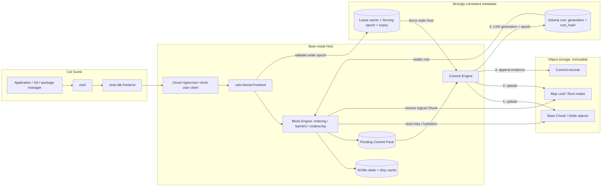

# Cats Direct-S3 ChunkStore（Direct-OS 实现）详细设计

> Agent 阅读约定：本文规定已选定的 Direct-S3（Direct-OS：Direct-ObjectStorage 接口的一种实现）后端的正确性协议（[ADR-0003](decisions/0003-direct-s3-chunkstore-backend.md)），不是现有实现说明。当前 Python/NBD 原型只验证语义；生产目标是 Rust `cats-blockd` 的 vhost-user-blk 多队列实现。

## 1. 结论与边界

Direct-S3（Direct-OS：Direct-ObjectStorage 接口的一种实现）ChunkStore 不是把一个 100GB raw image 上传到 S3，也不是让 Guest mount S3。它在 Host 上实现一个稀疏虚拟块设备：只把实际写过的逻辑区间保存为不可变对象，并通过一个很小的 Block Map 找到这些对象。

**Direct-OS 是接口名；本文只覆盖其中的 Direct-S3 实现**。

**Guest 接口保持不变**

Guest 只看到 `/dev/vda`、`/dev/vdb` 和标准 ext4。Guest 不安装存储客户端，不持有 S3 或 Metadata 凭证。

**远端 Ground Truth 与本地待发布真相**

Data Object、Delta Segment、Map Node 和 Commit Record 都是不可变对象。对
Strict，成功 FLUSH 的 Ground Truth 已在 S3/PostgreSQL；对 Relaxed，
`local_generation > remote_generation` 时本地 pending pack 是唯一权威副本，
不能当作可删除 Cache。

**Root 与 Lease 由强一致数据库管理**

PostgreSQL 保存当前 `root_hash`、Generation、Lease Owner 和 Fencing Epoch；它不保存用户数据块。

**FLUSH 按盘选择持久化边界**

Strict 只有 S3 对象上传完成且 Root CAS 成功后才 ACK；Relaxed 在 immutable
pending pack 完成本地 fsync/rename/directory fsync 后 ACK，由有界后台
publisher 异步推进远端水位。完整契约见
[ADR-0022](decisions/0022-relaxed-local-first-dual-watermark.md)。

**与现有架构的关系：**Cloud Hypervisor、vhost-user-blk、Guest ext4、RootDisk、PersistentDisk、MountBinding、Attachment 和 `cats` CLI 都不改变。本设计就是 `cats-blockd` 的数据路径（ADR-0003）；JuiceFS raw-file 方案已放弃，不再实现。

**不是性能承诺：**本文定义正确性协议和模块边界。上线仍必须通过真实 S3、真实 Cloud Hypervisor、git/package install、SQLite/fsync、故障注入和长期稳定性验收（见 §16 上线决策门）。

## 2. 核心架构决策

| 问题 | 决定 | 原因 |
|----|----|----|
| 块设备前端 | 生产使用 `vhost-user-blk`；开发/恢复增加 `ublk` 前端 | Cloud Hypervisor 直接消费 vhost-user 队列；ublk 便于在 Host 上执行 mkfs、fsck、fio 和恢复工具。 |
| 远端数据对象 | 4MiB Base Chunk；后续增加 64KiB 粒度的 Delta Record | 完整 Chunk 实现简单、便于先验证一致性；Delta 用于降低 ext4 Journal 和小文件随机写放大。 |
| 块映射 | 两级不可变 Merkle Radix Tree | 100GiB/4MiB 只有 25,600 个逻辑 Chunk；修改少量 Chunk 时只重写受影响 Leaf 和 Root。 |
| 权威指针 | PostgreSQL 中对 `generation + lease_epoch` 做 CAS | 避免依赖不同 S3-compatible 实现的条件写差异，并把 RWO fencing 放入同一原子检查。 |
| 本地持久状态 | NVMe Cache + Dirty Bitmap + Pending Commit Pack | 普通写低延迟；FLUSH 冻结屏障前的 Dirty Set 并生成不可变提交包，进程崩溃后可以幂等重试。 |
| 对象可变性 | Data、Delta、Map、Commit 全部不可变；只更新数据库 Root | 简化崩溃恢复、Snapshot、Clone 和并发读；失败提交最多制造不可见 Orphan。 |
| 多写者 | 只支持 RWO；每次 Attach 增加 Fencing Epoch | 同一个 ext4 镜像不能被两个 Writer 同时挂载；数据库中的 `attached=true` 不足以阻止旧 Host。 |
| 跨租户去重 | 第一版不做 | 降低加密、引用计数、信息泄露和删除语义复杂度；不可变 Map 仍会复用卷内未修改对象。 |

## 3. 完整架构图

图中绿色实线是数据路径，蓝色虚线是控制路径，紫色点线是 Root/Map/Lease 元数据路径。用户看不到右侧所有内部组件。



提交可见性顺序：`freeze Dirty Set → upload immutable Data/Delta → upload new Map nodes → Root CAS(generation, lease_epoch) → ACK FLUSH`。Root CAS 之前的对象不可见，最多成为可 GC 的 orphan；Root CAS 之后即使 ACK 丢失，重试也必须幂等识别已提交 generation。

块数据、Cache Hydration、对象上传 控制面、Attach、进程管理 Map、Root、Lease、Generation

**明确边界：**S3 保存数据和不可变历史，PostgreSQL 保存当前可见 Root 和写入所有权。只恢复 S3 但不恢复 Metadata DB，无法可靠判断哪个失败提交曾经通过 CAS；因此 Metadata DB 也必须高可用并持续备份。

## 4. 模块职责

Guest

### ext4

向上提供完整 Linux 文件语义，向下只产生标准块请求。

- 4KiB 数据和元数据块
- Journal、barrier、fsync
- DISCARD/TRIM
- 无需任何 Cats 存储代码

Hypervisor

### Cloud Hypervisor

向 Guest 暴露 virtio-blk，把 Virtqueue 交给 Host 侧 vhost-user backend。

- RootDisk → /dev/vda
- PersistentDisk → /dev/vdb...
- 支持多队列和热插拔
- 不理解 S3、Map 或 Lease

Node

### cats-blockd Frontend

实现 vhost-user-blk 协议并验证请求边界。

- READ / WRITE
- FLUSH / FUA
- DISCARD / WRITE_ZEROES
- 容量与只读模式

Node

### Block Engine

统一处理 I/O 顺序、Barrier、Map 查询、Cache Miss 合并和错误传播。

- 每个请求分配 write_seq
- FLUSH 捕获稳定序列
- 同 Chunk 写入串行化
- 读写并发与回压

Node

### Local Cache / Pending Store

NVMe 提供运行时性能；每次 FLUSH 用不可变 Pending Commit Pack 固定屏障前的提交输入。

- Clean Cache 可随时淘汰
- Dirty Cache 提交前不可删除
- Pending Pack 保存 txn、dirty extents 和 checksum
- Dirty Bitmap 使用 64KiB 页

Node

### Commit Engine

唯一可以发布新 Generation 的模块。

- 构造 Base/Delta 对象
- 上传并验证 checksum
- 创建新 Map Root
- 执行 Root CAS

Control plane

### Lease Store

确保一个 Volume 同时只有一个有效 Writer。

- Owner + TTL
- 单调递增 Epoch
- 续租与撤销
- CAS 时再次校验 Epoch

Durable

### S3 BlobStore

只接受不可变对象，提供 PUT、GET、Range GET、HEAD 和异步 DELETE。

- 服务端 checksum
- 对象加密
- 失败重试与幂等键
- Bucket/Prefix 租户隔离

Background

### Compactor / GC

Compactor 合并 Base + Delta；GC 只删除没有任何 Root 引用的旧对象。

- Snapshot-aware Mark
- Orphan grace period
- 对象库存扫描
- 限速和暂停机制

## 5. 远端数据格式

100GiB 是逻辑地址空间，不是一个必须上传的文件。按 4MiB Base Chunk 计算，共有 25,600 个逻辑 Chunk；Hole 不对应任何对象。

Volume Rootgeneration=42 · root_hash=R42

↓ 只引用不可变 Leaf Node

Leaf 0chunk 0–255

Leaf 1chunk 256–511

Leaf 2chunk 512–767

…未修改 Leaf 直接复用

↓ ChunkRef = Hole \| Base \| Base + Deltas

Base Object A4MiB · checksum

Hole读取返回全零

Base Object B4MiB · checksum

Delta 40 → 4264KiB records

``` code-block
tenants/<tenant-id>/volumes/<volume-id>/
  data/<object-id>                      # 4MiB Base Chunk，不可变
  deltas/<transaction-id>               # 一个 FLUSH 的 Delta Pack，不可变
  maps/<sha256>.node                    # Root / Leaf Node，不可变
  commits/<generation>-<transaction>    # 审计和恢复记录，不可变

PostgreSQL volumes:
  volume_id
  tenant_id
  kind                 # root | persistent
  size_bytes
  root_hash
  generation
  lease_owner
  lease_epoch
  lease_expires_at
  state                # available | attaching | attached | deleting
```

### Base Data Object

- Header：format、volume、logical chunk、plaintext length
- Compression：v1 可关闭，后续按 Chunk 决定
- Encryption：每 Volume DEK，KMS 包装
- Integrity：明文 SHA-256 + 远端对象 checksum
- Object ID：v1 使用随机 ID，不做跨租户内容寻址

### Map Node

- 使用确定性二进制编码，不使用字段顺序不稳定的 JSON
- Node Hash 覆盖完整编码内容
- Leaf 保存 ChunkRef 和 Delta offset/length
- Root 保存 Leaf Hash
- 读取任何对象后都必须验证 Hash/Checksum

## 6. I/O 数据路径

### 6.1 读路径

Guest READLBA + length

→

Volume MapHole / Base / Delta

→

NVMe CacheHit 直接返回

或

S3 GET校验、hydrate、返回

**Cold Start：**Attach 时只加载 Volume Row、Root Node 和启动过程中读到的 Leaf。第一次读取某个 Chunk 才访问 S3；多个相同 Cache Miss 必须合并成一次下载。Hole 直接返回零，不产生 S3 请求。

### 6.2 普通写路径

Guest WRITE4KiB～大块 I/O

→

Mark Dirty先保守标记 64KiB page

→

NVMe Cache覆盖对应 bytes

→

WRITE ACK尚未承诺远端持久

**Write Cache 语义：**普通 WRITE 可以在写入本地内存/NVMe 后返回，但必须向 Guest 正确声明 volatile write cache。Host 在 FLUSH 前永久损坏时，未 fsync 数据允许丢失；已经成功完成 FLUSH/FUA 的数据不允许丢失。

**V1 不实现逐写 WAL：**普通写不为每个 4KiB 请求追加数据库式日志。只有 FLUSH 到来时，才把屏障前的 Dirty Set 固定成不可变 Pending Commit Pack。若未来要让已 ACK 但尚未 FLUSH 的普通写也能承受整台 Host 永久丢失，需要跨 Host 复制的日志或同步远端提交；单机 NVMe WAL 仍然不够。

### 6.3 DISCARD / TRIM

完整 Chunk 的 DISCARD 把对应 ChunkRef 改为 Hole；部分 Chunk 的 DISCARD 记录 Zero Delta 或在 Compaction 时归零。不会同步删除 S3 对象，因为旧 Snapshot 可能仍然引用它。

## 7. FLUSH/FUA 提交协议

提交顺序仍必须是“本地 pack 先持久、对象先持久、Root 后发布、本地 pack
最后清理”，不能交换。每卷维护两个单调水位：

- `L = local_durable_generation`：相应 pending pack 已在本地 NVMe 持久；
- `R = remote_durable_generation`：相应对象和 Map 已上传且 Root CAS 成功。

始终满足 `R <= L`。Strict 在 `R == L` 后 ACK；Relaxed 在 `L` 前进后 ACK，
步骤 3–6 只由后台 publisher 执行。Relaxed 冷缓存上的局部 WRITE 记录精确
byte ranges，不在 Guest WRITE/FLUSH 线程中同步 GET 旧 page；publisher
读取远端 base、按 generation 顺序合并这些 ranges，再产生 64 KiB delta 或
4 MiB base。冷 READ 仍可能依赖 S3。

步骤

Guest/ext4

cats-blockd

Local NVMe

S3

PostgreSQL

1

发送 FLUSH/FUA

捕获 dirty_seq ≤ N，建立 txn

—

—

—

2

等待，不返回

冻结 N 的 Dirty Set；后续写进入新集合

创建 Pending Pack 并 fdatasync

—

—

3

等待

构造 Base Chunk 或 Delta Pack

读取 dirty extents

PUT Data/Delta + checksum

—

4

等待

创建新 Leaf 和 Root

—

PUT Map Nodes + Commit Record

—

5

等待

提交 root=R(N+1)

—

对象已经可读

CAS generation + epoch + owner

6

等待

确认远端 Generation 已发布

清该集合 Dirty；Pending Pack 可删

—

新 Root 可见

7

收到成功

Strict 在 R 前进后 ACK；Relaxed 在步骤 2 的 L 前进后已 ACK

清理已提交 Pending Pack

—

—

``` code-block
UPDATE volumes
SET root_hash       = :new_root,
    generation      = generation + 1,
    updated_at      = now()
WHERE volume_id     = :volume_id
  AND generation    = :expected_generation
  AND lease_epoch   = :expected_epoch
  AND lease_owner   = :this_attachment;

-- affected_rows 必须恰好为 1，否则本次远端发布失败。
```

`lease_expires_at` 决定竞争者何时可以 acquire，不参与当前 owner/epoch 的
Root CAS。竞争 acquire 或显式 revoke 必须先增加 epoch；旧 epoch 随后 CAS
为 0 行并永久 fenced。仅仅 lease renewal 因调度/DB 抖动短暂越过 expiry，
而 owner/epoch 尚未变化时，不应自我 fencing。

### CAS 前崩溃

旧 Root 继续可见。已经上传的对象没有 Root 引用，经过安全等待期后由 GC 删除。

### CAS 后、ACK 前崩溃

新 Root 已经是 Ground Truth。重启后根据 txn/generation 识别已提交状态，只清理 Pending Pack，不重复增加 Generation。

### CAS 失败

Generation、owner 或 epoch 冲突说明 Writer 已被 Fence，立即停止写路径，
不能覆盖新 Owner 的 Root。S3/DB timeout、连接错误和限流只记录为可重试的
publish error：Relaxed 保留本地 pack，不能把瞬时远端错误直接作为 Guest
FLUSH 的 EIO。

**延迟与风险边界：**Strict FLUSH 至少包含一次 S3 PUT 完成和一次 Metadata
CAS；Relaxed FLUSH 的关键路径是本地 pack 持久化，但 Host 永久损坏只恢复到
`R`，会丢当时的 `L-R`。要同时获得本地级 fsync 和 Host-loss RPO 0，必须增加
跨 Host Replicated Write Log，不能靠缩短后台定时器冒充。

## 8. RWO Lease 与 Fencing

Lease 负责判断谁应该写；Fencing Epoch 负责阻止已经失联但仍在运行的旧 Host 发布新 Root。两者缺一不可。

Available无 Writer

→

Attach Txnepoch 41 → 42

→

AttachedHost B / epoch 42

→

Flush CAS必须携带 epoch 42

→

Detachflush + release

### 正常迁移

1.  停止 Guest 新写入。
2.  完成最终 FLUSH，记录 final root。
3.  Host A 关闭 vhost-user backend。
4.  释放 Lease。
5.  Host B 获取 epoch+1。
6.  空 Cache 加载 Root，启动 Guest。

### Host A 突然失联

1.  控制面等待 Lease 到期或执行受控撤销。
2.  Host B 获取更大的 Epoch。
3.  Host A 即使恢复，也无法通过 Root CAS。
4.  Host A 上传的对象没有新 Root 引用，只会成为 Orphan。
5.  Host B 从最后一次成功 FLUSH 的 Root 恢复。

**禁止行为：**不能因为 S3 支持多客户端读取，就允许两个 cats-blockd 同时写同一个 ext4 Volume。两个 Writer 分别修改不同 LBA 也不安全，因为 ext4 Journal 和分配器仍然是同一个文件系统。

## 9. RootDisk 与 PersistentDisk 生命周期

| 阶段 | RootDisk | PersistentDisk | 存储动作 |
|----|----|----|----|
| Create | 随 Cat 自动创建，可从 Golden Root 克隆 Root | 由用户显式创建或在 `cats create --disk` 时创建 | 创建 Volume Row；Root 指向空 Map 或 Golden Snapshot；无需复制所有 Chunk。 |
| Attach | 固定作为 Guest 系统盘 | 一次只能挂到一个 Cat，可动态挂载 | 分配 Fencing Epoch，启动 cats-blockd，Cloud Hypervisor 添加设备。 |
| Active | 普通系统盘读写 | Guest 中挂载到 /data 等路径 | NVMe Cache 加速；FLUSH 提交到 S3 + Metadata。 |
| Cold | Cat 停止但 Volume 保留 | 如果仍 Bound，MountBinding 保留；也可先 Detach | 最终 FLUSH；关闭 backend；删除本地 Cache；远端 Root 不变。 |
| Wake/Migrate | 新 Host 从最后 Root 启动 | 在新的 Cat/Host 上重新 Attach | 只加载 Root/Leaf；数据按需 GET，不搬迁整个逻辑盘。 |
| Cat Destroy | 进入 deleting，最终删除 | 保留；先安全 Detach | RootDisk Tombstone 后异步 GC；PersistentDisk 不受影响。 |
| Disk Delete | 随 Cat Destroy | 用户显式执行，必须无有效 Attachment | 撤销访问、保留安全期、删除 Volume Prefix 和 Metadata Row。 |

``` code-block
# 用户接口不暴露 S3、Map、Cache、Lease 或 Socket
cats create dev
cats create dev --disk project-data --disk-size 100GiB --mount-at /data

cats disk create project-data --size 100GiB
cats mount project-data --cat dev --at /data
cats unmount project-data --cat dev
cats disk resize project-data --size 500GiB

cats destroy dev              # RootDisk 删除，PersistentDisk 保留
cats disk delete project-data # 只有 Available 状态允许删除
```

## 10. Snapshot、Clone、Restore 与 GC

### Checkpoint / Snapshot

1.  对 Active Volume 建立 Barrier。
2.  完成一次远端 FLUSH。
3.  把当前 `root_hash + generation` 写入 Snapshot Row。
4.  解除 Barrier。

不复制 Base Chunk、Delta 或 Map Node。

### Clone

1.  新 Volume 创建新的 ID 和 Lease 状态。
2.  初始 Root 指向同一个不可变 Map Root。
3.  后续写入创建新的 Leaf、Root 和 Data Object。
4.  旧对象由两个 Root 共同引用。

### Restore

1.  拒绝或冻结新写入。
2.  完成当前写入的处理策略：提交或明确丢弃。
3.  数据库将 Volume Root CAS 到 Snapshot Root。
4.  Generation 增加，失效本地 Clean Cache。
5.  重新开放设备。

### Mark-and-Sweep GC

1.  以所有 Active Volume Root 和 Snapshot Root 为起点。
2.  遍历 Root、Leaf、Base、Delta 引用。
3.  形成 Live Object 集合。
4.  只删除未引用且早于 Grace Period 的对象。
5.  GC 进度和删除清单必须可审计。

**不能仅靠引用计数：**上传对象后、Root CAS 前随时可能崩溃；Snapshot 删除、Clone 和并发 GC 也会造成引用计数时序问题。不可变对象 + 周期性 Mark-and-Sweep 更容易证明正确。

## 11. 小文件与写放大

10 万个 Guest 文件不会变成 10 万个 S3 对象。cats-blockd 看不到文件名，只看到 ext4 写入的 LBA。但 ext4 Journal、inode table、目录块和重复 FLUSH 会反复改写少量热区，因此完整 4MiB Chunk 上传会造成写放大。

| 阶段 | 远端表示 | 优点 | 问题/触发条件 |
|----|----|----|----|
| V1：Full Chunk | 每个 Dirty 逻辑 Chunk 生成新的 4MiB Base Object | 代码简单；读路径简单；容易验证崩溃一致性 | 4KiB 写也可能上传 4MiB；只适合功能验证和初期小规模。 |
| V2：Delta Pack | 一次 FLUSH 将多个 64KiB Dirty Page 打包成一个 Segment | 减少 PUT 数和传输字节；适合 ext4 Journal 和 Git 小文件 | 读时需要 Base + Delta 合并；Map 保存 segment offset/length。 |
| Compaction | 后台把 Base + 多个 Delta 合并为新 Base | 限制读放大和 Delta Chain 长度 | 建议在 delta_count \> 4、delta_bytes \> 50% base 或 Chunk 变热时触发。 |

``` code-block
DeltaSegment {
  format_version
  volume_id
  transaction_id
  lease_epoch
  records[] {
    logical_chunk_index
    offset_in_chunk        # 64KiB 对齐
    length
    plaintext_checksum
    payload_offset
  }
  encrypted_payload
  segment_checksum
}

ChunkRef {
  base_object
  deltas[] { segment_id, record_offset, record_length }
}
```

**基准必须看四个量：**`guest_bytes_written`、`remote_bytes_uploaded`、S3 PUT 数和 Compaction Bytes。只看最终对象容量会掩盖重复上传与后台整理成本。

## 12. 租户隔离、凭证与加密

### 权限边界

- Guest 永远拿不到 S3/DB 凭证。
- cat-agent 只给 blockd 发送短期 Volume Token。
- Token 限定 tenant、volume、attachment、epoch 和操作。
- blockd 使用节点身份换取短期远端凭证。

### 对象加密

- 每个 Volume 独立 DEK。
- DEK 由平台 KMS KEK 包装。
- 对象 Header 作为 AEAD Associated Data。
- Map 中保存 key_version。
- 后台重写完成密钥轮换。

### 完整性

- 上传提供服务端 checksum。
- Map 保存明文或规范编码 Hash。
- 下载后再次验证。
- 校验失败不写入 Clean Cache。
- 错误进入只读/故障状态并告警。

**第一版不做跨租户去重：**跨租户内容寻址可能泄露“另一个租户是否拥有某段数据”，并让密钥轮换、引用追踪和删除证明复杂化。Volume 内通过不可变 Root 复用未修改对象已经能获得主要 CoW 收益。

## 13. 故障处理矩阵

| 故障 | 正确行为 | 不能发生 | 恢复动作 |
|----|----|----|----|
| blockd 进程崩溃 | 同 Host 从 Pending Pack 重建 `L`；旧 Root 保持完整 | attach 恢复阶段先做远端写或跳过已 ACK pack | 先恢复本地队列，再由 publisher 按 generation 幂等重放。 |
| Host 永久损坏 | Strict 从最后成功 FLUSH 恢复；Relaxed 从 `R` 恢复并报告丢失窗口 | 把定时器误报成真实 RPO | 新 Host 获取更高 Epoch；空 Cache Cold Start；以故障时 `L-R` 的 age/bytes/generations 记账。 |
| S3 PUT 超时 | Strict FLUSH 等待/失败；Relaxed ACK 本地 pack，publisher 重试同一 Object ID | 将普通 timeout 当 fencing，或直接向 Relaxed ext4 注入 EIO | 保留 pack 和 lease；记录 publish error；远端恢复后继续。 |
| S3 返回损坏数据 | Checksum 失败，拒绝将数据交给 Guest | 把损坏内容写入 Cache 后继续运行 | 重试、读取其他副本/区域；无法恢复时 Volume 进入 Faulted。 |
| PostgreSQL 不可用 | Clean Cache 读继续；Strict FLUSH 等待/失败；Relaxed 本地推进到配额水位 | 绕过 CAS，或让本地队列无界增长 | 有界队列和 deadline；只剩 pin 数据时背压；数据库恢复后重连/重试。 |
| Lease renewal 越过 expiry | owner/epoch 未变时继续 renew/publish | 因瞬时抖动自我 fence | 竞争 acquire/revoke 增加 epoch 后，旧 Writer 才 fail closed。 |
| 强制 lifecycle drain 失败 | Stop/Warm/Snapshot/Detach/迁移不越过远端持久化边界 | 释放 lease、删除 runtime/pending 或宣称 Cold | 保留 blockd、journal 和 lease；控制器重试到 `R == L`。 |
| GC 进程崩溃 | 最多延迟空间回收 | 删除任何仍被 Root/Snapshot 引用的对象 | GC Job 使用 epoch、checkpoint 和幂等 delete，重新扫描。 |
| Compaction 崩溃 | 旧 Base + Delta 仍可读 | 先删除旧对象再发布新 Map | 新 Base 成为 Orphan 或在重试时复用；Root CAS 后才允许旧对象进入 GC。 |

## 14. 可观测性与目标

下列数字是设计目标，不是已经验证的承诺。必须分别统计 Cache Hit、Cold Miss、普通写和 FLUSH，不能用平均延迟掩盖远端提交。

**\< 1ms**目标：NVMe Cache Hit READ P99

**\< 1ms**目标：非 FUA 本地 WRITE P99

**分别实测**Strict 远端 FLUSH 与 Relaxed 本地 FLUSH P50/P99

**\> 95%**目标：稳态工作集 Cache Hit Rate

| 类别 | 必须导出的指标 |
|----|----|
| I/O | read/write/flush/trim IOPS、bytes、P50/P95/P99、queue depth、barrier wait |
| Cache | hit/miss、hydrated bytes、eviction、clean/dirty/pinned bytes、allocated/accounted/max local bytes、NVMe fsync latency |
| Remote | GET/PUT 数、bytes、latency、retry、checksum failure、throttle、error code |
| Commit | local/remote generation、unpublished generations/bytes/oldest age、publish error、backpressure、CAS conflict、fenced |
| Lifecycle | attach latency、cold start first-read、migration time、lease renewal、fencing event |
| Space | live bytes、orphan bytes、snapshot retained bytes、GC reclaimed bytes、compaction amplification |

## 15. 实施计划

本设计是唯一数据路径（ADR-0003），直接面向生产 Rust 实现。按
[ADR-0005](decisions/0005-provider-neutral-storage-ports-and-adapters.md)，
`BlobStore`/`MetadataStore` 是长期 provider-neutral ports；File/SQLite 是开发
adapter，AWS S3 是第一版 durable object-store adapter。具体厂商协议、SDK、凭据
和参数只允许存在于 `adapters/` 与进程 composition root，不进入 `ChunkEngine`。

| 阶段 | 实现内容 | 退出条件 |
|----|----|----|
| P0：已有 Demo | Python/NBD、固定 Chunk、Generation Manifest、原子 HEAD、真实 JuiceFS 对照、崩溃注入 | 已完成：冷恢复、HEAD 前后崩溃和兼容 ext4 验证通过。 |
| P1：接口拆分 | `BlockEngine`、`LocalCache`、`BlobStore`、`MetadataStore` 四个边界；契约位于 `cats-storage`，实现位于独立 adapter crate | 相同契约测试在 File adapter 与 AWS S3 兼容测试端点上通过；核心 crate 不依赖厂商实现。 |
| P2：Rust 正确性版本 | 4MiB Full Chunk、两级 Map、PostgreSQL CAS、Lease/Fencing、S3 checksum | NBD/ublk 下 ext4、fsck、fio、kill -9 和 stale-writer 测试通过。 |
| P3：虚拟化接入 | vhost-user-blk、多队列、Cloud Hypervisor 动态磁盘、RootDisk boot | 真实 Guest 中系统盘和 PersistentDisk 生命周期通过。 |
| P4：空间与小写优化 | Delta Pack、Compaction、TRIM、Snapshot/Clone、Mark-and-Sweep GC | git clone、apt/npm、SQLite fsync 的远端写放大和延迟达到阈值。 |
| P5：生产强化 | KMS、Credential Broker、限流、配额、审计、在线升级、跨 AZ 恢复、容量计划 | 故障演练、72h soak、升级回滚、数据恢复 Runbook 通过评审。 |
| P6：生产灰度 | 按 Volume/租户比例灰度启用生产 `cats-blockd`；read-only attach、raw export 与回滚 Runbook | 先小比例 PersistentDisk 再 RootDisk；出现错误可 Detach、只读挂载并导出恢复。 |

``` code-block
trait BlobStore {
    async fn put_immutable(object_id, bytes, checksum) -> PutResult;
    async fn get(object_id, range) -> Bytes;
    async fn head(object_id) -> ObjectMetadata;
    async fn delete_batch(object_ids) -> DeleteResult;
}

trait MetadataStore {
    async fn acquire_lease(volume, attachment, ttl) -> LeaseEpoch;
    async fn renew_lease(volume, attachment, epoch, ttl);
    async fn load_head(volume) -> VolumeHead;
    async fn compare_and_swap_head(expected, next, attachment, epoch);
    async fn create_snapshot(volume, root, generation) -> SnapshotId;
}
```

## 16. 验收与故障注入

### 正确性

- ext4 mkfs、mount、unmount、journal replay
- tree digest 冷恢复一致
- fsck.ext4 强制检查
- fio verify、fsx、随机断电点
- TRIM 后读取全零
- Snapshot/Restore/Clone 内容一致

### 故障注入

- Data PUT 前、中、后 kill -9
- Map PUT 后、CAS 前崩溃
- CAS 后、ACK 前崩溃
- lease expiry lapse、竞争 acquire/revoke 和旧 Host 恢复
- S3 延迟、5xx、超时、损坏响应
- PostgreSQL failover 和重复事务
- Relaxed 远端失败期间的本地 ACK、配额/淘汰/背压
- Stop/Warm/Snapshot/Detach/Node drain 失败时源状态保留与重试

### 工作负载

- 100GiB / 100,000 小文件
- git clone、checkout、gc
- apt、npm、pip install
- SQLite WAL + 每事务 fsync
- PostgreSQL/MySQL 开发实例
- Docker/OCI layer 解包

### 必须记录

- 远端上传/下载字节
- S3 GET/PUT 数和费用模型
- Full Chunk 与 Delta 写放大
- Strict 远端 FLUSH 与 Relaxed 本地 FLUSH P50/P99
- `L-R` generations/bytes/oldest age 与 publisher throughput
- Cold Start 首次响应和 Hotset
- GC/Compaction 对前台 I/O 的影响

**上线阻断条件：**Strict 的成功 FLUSH 在删除整台 Host 后无法恢复；Relaxed
未明确/暴露故障时 `L-R`；强制 drain 失败后仍删除唯一的本地副本；旧
Fencing Epoch 能发布 Root；GC 能删除可达对象；Checksum 错误未被发现；或
无法给出明确的 pending/local 物理上限。当前上限是每卷隔离，不等价于 Host
全局容量证明，节点仍必须为所有卷、Warm snapshot、日志和系统空间做总预算。

### 上线决策门

| 比较项 | Direct-S3（Direct-OS 实现）必须证明 |
|----|----|
| 正确性 | FLUSH、FUA、TRIM、Snapshot、Fencing 和恢复语义通过本节全部故障注入与工作负载验收。 |
| 延迟 | Cache Hit READ/WRITE P99 达到 §14 目标；FLUSH P50/P99 达到产品可接受范围。 |
| 成本 | S3 请求费、写放大、Compaction 和 GC 后的总成本满足产品成本模型（按真实 workload 测算）。 |
| 运维 | 能够定位某个 LBA 对应的 Root、Map、Data、Delta、Checksum 和提交事务。 |
| 恢复 | 有可执行的 Volume Verify、Read-only Attach、Export Raw、Rebuild Cache 和灾难恢复工具。 |

## 17. 参考资料

- [Amazon S3 consistency model](https://docs.aws.amazon.com/AmazonS3/latest/userguide/)
- [Amazon S3 conditional requests](https://docs.aws.amazon.com/AmazonS3/latest/userguide/conditional-requests.html)
- [Amazon S3 object integrity](https://docs.aws.amazon.com/AmazonS3/latest/userguide/checking-object-integrity-upload.html)
- [Linux ublk](https://docs.kernel.org/block/ublk.html)
- [Cloud Hypervisor vhost-user-blk](https://github.com/cloud-hypervisor/cloud-hypervisor/blob/main/docs/vhost-user-blk-testing.md)
- [QEMU Storage Daemon](https://www.qemu.org/docs/master/tools/qemu-storage-daemon.html)
- [ADR-0003：存储后端选定 Direct-OS ChunkStore](decisions/0003-direct-s3-chunkstore-backend.md)
- [lazy-ext4 Demo](../experiments/lazy-ext4-demo/README.md)
- [Cats 存储产品蓝图（历史参考）](cats-storage-product-blueprint.md)
- [Sprite 存储路径说明](sprite-storage-flow.md)
