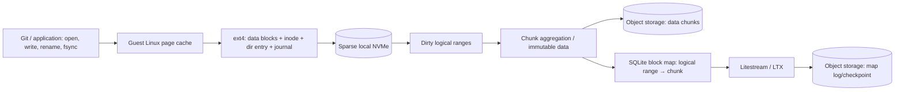
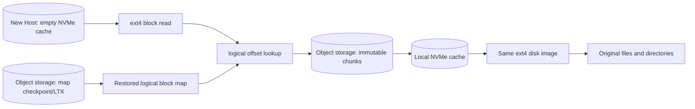

# Sprite 存储路径：10 万小文件去了哪里？

## 结论

10 万个小文件、总数据约 100 MiB，即使分散在一个逻辑容量 100 GiB 的 ext4 磁盘上，也不意味着需要上传整个 100 GiB 虚拟盘。

公开资料描述的核心形态是：

- 用户和 Git 操作本地 ext4，获得标准 POSIX 和 Git 文件协议语义。
- 本地 NVMe 是稀疏热层，逻辑容量不等于实际占用。
- 文件变化最终表现为 ext4 数据块、inode、目录项、bitmap 和 journal 的变化。
- 存储层把实际变化的逻辑区间聚合为不可变数据 Chunk。
- SQLite/Litestream 一类机制保存“逻辑块位置 → 数据 Chunk”的映射和恢复元数据。
- 对象存储保存可恢复的数据本体和映射日志，而不是按用户文件名保存对象。

一句话：**上传的是被修改并需要持久化的 Chunk 和映射变化，不是整个 NVMe，也不是一文件一个对象。**

## 公开事实与推断边界

| 类型 | 内容 |
|---|---|
| 公开描述 | 稀疏 100 GiB NVMe、immutable chunks、SQLite block map、Litestream、对象存储、Cold 后从远端恢复 |
| 结构性推断 | ext4 逻辑块变化必须被某个块映射结构关联到 immutable chunk，Cold 恢复必须先恢复或读取该映射 |
| 未公开 | 实际 Chunk 大小、聚合/压缩策略、数据与 metadata 的原子提交顺序、最坏写放大、缓存淘汰算法 |

本文不是 Sprites 内部实现文档，也不代表标准 JuiceFS 的默认架构。Cats 只能借鉴已验证的思想，不能依赖未公开细节。

## 写入路径



这条路径包含两个不同的持久化流：

1. **数据流**：变化的 ext4 逻辑范围成为 immutable data chunks。
2. **映射流**：逻辑位置到 Chunk 的映射成为 SQLite/LTX 变化并进入对象存储。

公开资料没有完整说明二者的事务边界。因此设计 Cats 时必须自行定义：何时能向 Guest ACK FLUSH、数据对象与 Root/Map 谁先发布、崩溃后如何判断可见 generation。

## Cold 恢复路径



Cold 恢复不要求先下载 100 GiB。系统只需要：

1. 获得当前可见的映射 Root/checkpoint。
2. 启动一个逻辑容量相同的稀疏块设备。
3. ext4 请求某个逻辑区间时查 Map。
4. 命中已映射 Chunk 才从对象存储下载；洞返回零。
5. 下载的数据进入本地 Cache，后续读取直接命中。

## 一个文件在四层中的表示

| 层 | `src/main.c` 的表示 | 该层是否知道文件名 |
|---|---|---|
| Git/POSIX | `src/main.c`；open/write/rename/fsync | 是 |
| ext4 | 数据 block、inode、directory entry、allocation bitmap、journal record | ext4 知道目录项；下层块设备不知道 |
| Chunk 存储层 | 被修改的逻辑范围及其对应 immutable Chunk | 否 |
| 对象存储 | data chunk 对象和 block-map/LTX 对象 | 否 |

因此：

- Git 的 HTTPS、SSH、`file://` 协议只要求上层文件系统提供正确 POSIX 语义，与底层是否 S3 无关。
- 10 万个文件不等于 10 万次 S3 PUT。多个小文件及其 metadata 可以落在同一个 Chunk；一个文件也可能跨多个 Chunk。
- 小文件仍可能产生明显写放大，因为 inode、目录项、bitmap 和 journal 都会变化。
- 实际远端数据量取决于 Chunk 粒度、ext4 布局、工作负载和压缩/聚合策略，不只取决于用户文件大小总和。

## 100 GiB 逻辑盘的正确心智模型

```text
logical disk capacity = 100 GiB
mapped/touched extents << 100 GiB
uploaded objects ≈ unique committed dirty chunks + mapping metadata
```

不应使用下面的模型：

```text
100 GiB virtual disk -> dump 100 GiB image -> upload one huge object
```

也不应假设物理 NVMe sector 与远端 Chunk 一一对应。正确映射发生在**Guest 逻辑块地址空间**：连续的逻辑 LBA 范围被聚合为存储 Chunk；Host NVMe 物理扇区位置是 Linux/设备内部细节。

## 对 Cats 的可借鉴部分

- Guest 保持未修改的 ext4 和标准块接口。
- 对象存储是 durable truth，本地 NVMe 是可丢 Cache。
- 只提交 dirty logical Chunk，不扫描或上传整盘。
- 使用不可变对象和小型权威 Root/Map 发布新 generation。
- Cold Host 可以从空 Cache lazy restore。

Cats 仍必须自行实现和验证：

- Guest FLUSH/FUA 到远端 durable generation 的精确定义。
- 单写者 lease 和 fencing epoch。
- 数据对象、Map、Root 的崩溃一致性。
- 并发 GET、预取、Cache 水位和 wake storm admission。
- Snapshot/Clone/GC、加密、租户隔离和审计。

## 相关 Cats 实验

- [Lazy ext4 over ChunkStore](../experiments/lazy-ext4-demo/README.md)
- [存储与生命周期实验总报告](experiments-2026-07-21-storage-lifecycle.md)
- [Cats 存储架构设计](cats-storage-product-blueprint.md)
- [Direct-S3 ChunkStore（Direct-OS 实现）设计](direct-s3-chunkstore-architecture.md)

## 公开参考资料

- [The Design & Implementation of Sprites](https://fly.io/blog/design-and-implementation/)
- [Litestream VFS](https://fly.io/blog/litestream-writable-vfs/)
- [Sprites product page](https://fly.io/sprites)
